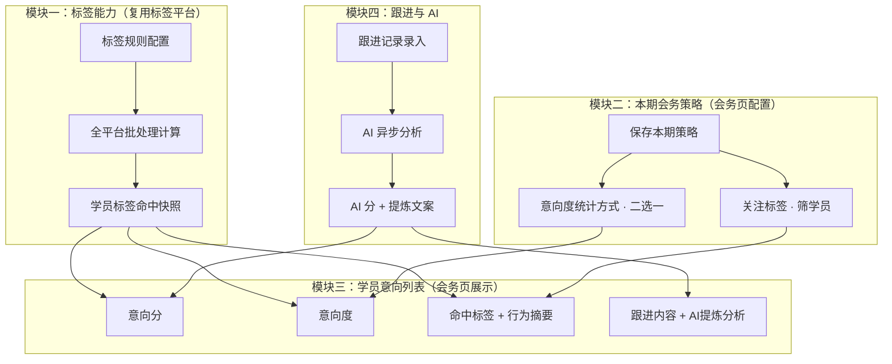
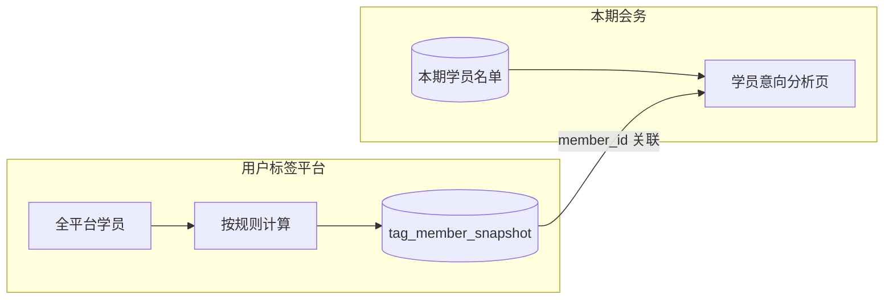
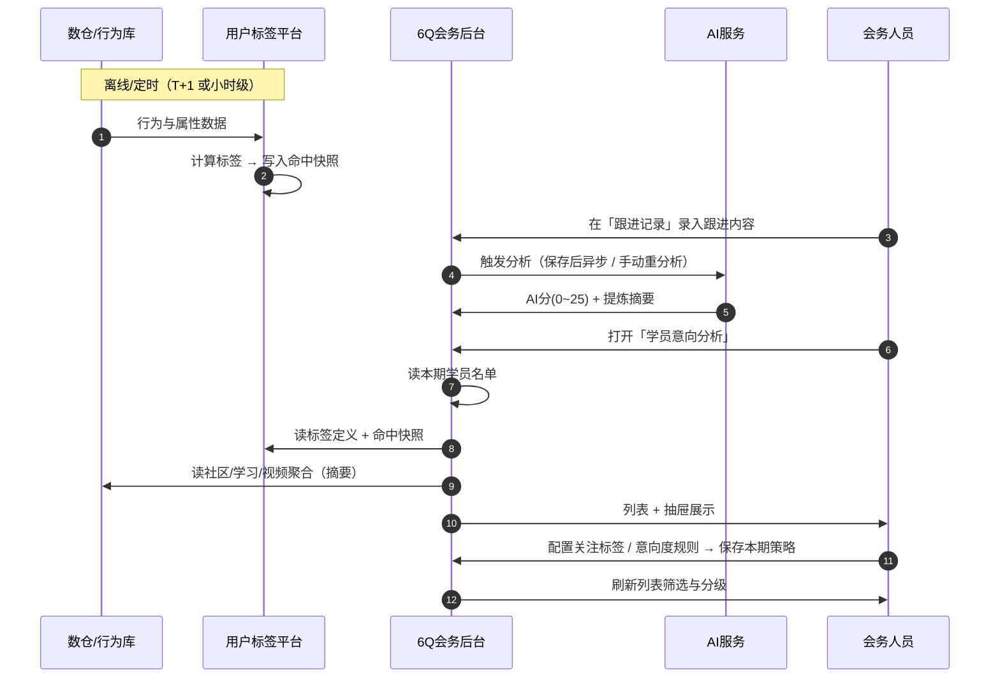
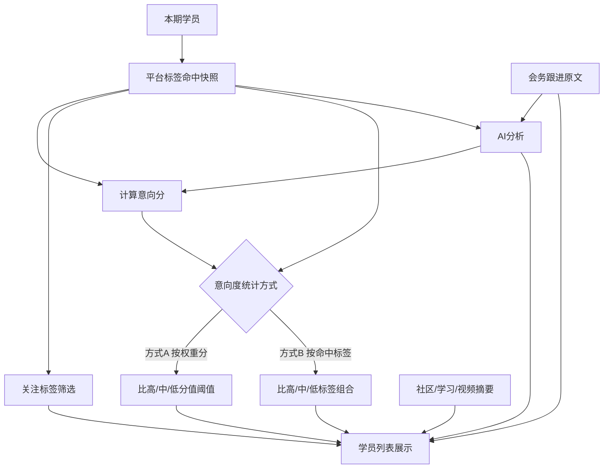
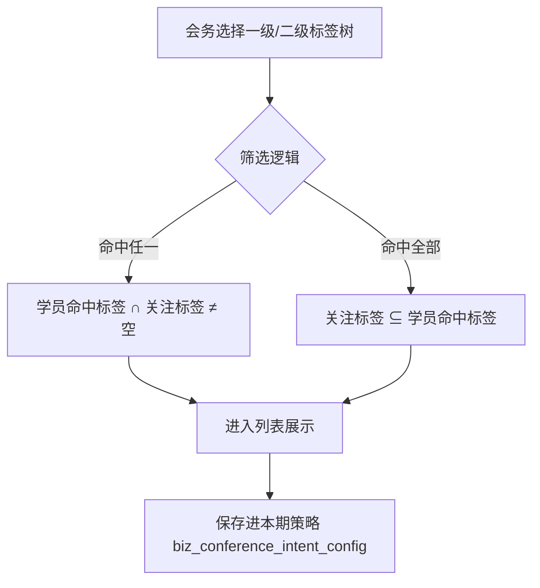
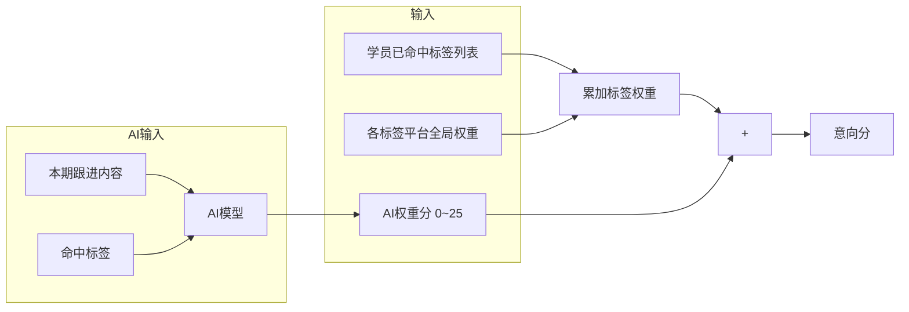
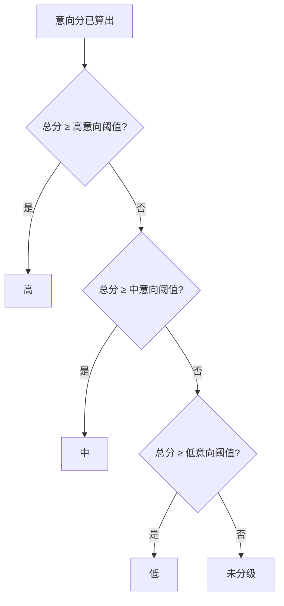
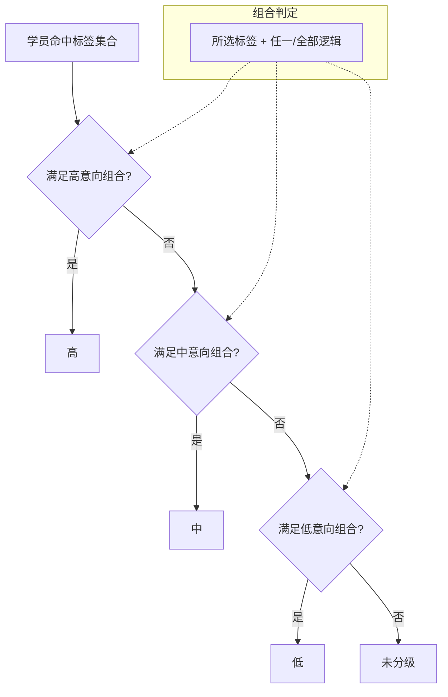
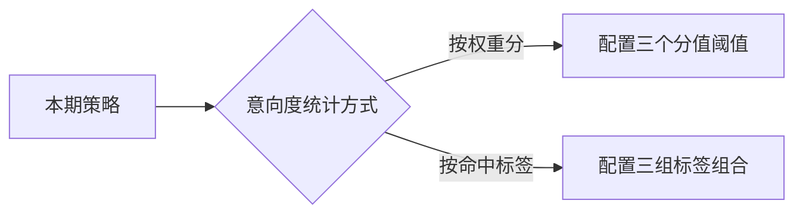
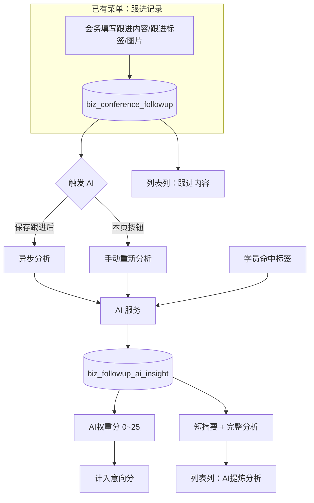

# 课程会务 · 学员意向分析 — 产品方案稿

> **版本：** v1.1（标签圈选改为 NL→SQL；详见 [HANDOFF-v1.1.md](./HANDOFF-v1.1.md)）  
> 上一方案确认基线：v1.0  
> **阅读对象：** 产品 / 业务 / 研发 / 测试  
> **交互原型：** `6q-conference-prototype/conference-student-intent.html`  
> **技术详设：** `DESIGN.md`

---

## 一句话方案

在 **课程会务详情** 增加 **「学员意向分析」** 页：基于 **用户标签平台** 的全平台标签命中结果，只针对 **本期学员** 做筛选、打分与分级；结合 **会务跟进（人工）** 与 **AI 提炼（模型）**，在一屏看清谁更值得跟、为什么。

---

## 方案稿目录（本文结构）

| 章节 | 内容 | 你将看到 |
|------|------|----------|
| **§1** | 方案整体目录 | 系统模块划分、页面组成 |
| **§2** | 数据采集范围 | 采什么、谁负责采、会务怎么用 |
| **§3** | 总体数据流 | 从数仓到列表的一张总图 |
| **§4** | 核心规则与流程图 | 关注标签、意向分、意向度、跟进与 AI |
| **§5** | 页面与列表设计 | 配置区 + 列表列 + 抽屉 |
| **§6** | 系统边界与分期 | 做什么 / 不做什么 / P0–P2 |
| **§7** | 方案确认清单 | 请你勾选或批注 |

---

## §1 方案整体目录

### 1.1 在 6Q 后台的位置

```
6Q 后台管理系统
└── 计划与实施
    └── 线下课程会务
        └── 课程会务
            └── 课程会务详情（某一期）
                ├── 基础信息          （已有）
                ├── 报读记录          （已有）
                ├── 学员信息          （已有）
                ├── 跟进记录          （已有 · 人工录入跟进）
                ├── …                 （已有子菜单）
                └── 【新增】学员意向分析   （本方案 · 只读分析）
```

### 1.2 本方案包含的模块



| 模块 | 建设方 | 说明 |
|------|--------|------|
| 标签平台 | 已有系统扩展 | 规则、计算、快照；会务 **只读消费** |
| 本期策略 | 本方案新增 | 每期会务可保存一套筛选与分级规则 |
| 意向列表 | 本方案新增 | 分析页主体 |
| 跟进 + AI | 本方案增强 | 录入不变；新增 AI 分与提炼展示 |

---

## §2 数据采集范围

**原则：** 会务页 **不新造规则引擎**；能做成标签的优先在 **标签平台** 配置，会务只 **选用 + 展示 + 计分**。

### 2.1 采集范围总表

| 数据类型 | 采集/计算范围 | 负责系统 | 是否在本页配置规则 | 会务页用途 |
|----------|---------------|----------|-------------------|------------|
| **学员身份** | 本期会务报名/参课名单 | 6Q 会务 | — | 名单范围（只看本期学员） |
| **标签命中** | **全平台学员** | 用户标签平台 | ❌ 在标签平台配 | 命中展示、意向分、意向度（模式 B） |
| **标签权重** | 全平台统一配置 | 用户标签平台 | ❌ 在标签平台配 | 意向分加总 |
| **社区行为** | 全平台行为库 | 数仓 / 标签平台 | 优先沉淀为标签 | 列表 **摘要** + 抽屉明细 |
| **学习行为** | 全平台行为库 | 数仓 / 标签平台 | 优先沉淀为标签 | 列表 **摘要** + 抽屉明细 |
| **视频行为** | 全平台行为库 | 数仓 / 标签平台 | 优先沉淀为标签 | 列表 **摘要** + 抽屉明细 |
| **会务跟进** | **本期会务** 下该学员 | 6Q「跟进记录」 | ❌ 在本菜单录入 | 列表「跟进内容」列 |
| **AI 分析** | 本期学员 + 标签 + 跟进 | AI 服务 | ❌ 自动/手动触发 | 列表「AI提炼分析」列 + AI 分 |

### 2.2 标签：全平台算、会务只用交集



| 要点 | 说明 |
|------|------|
| 计算对象 | 标签规则面向 **全平台学员**（例：亲子视频累计 >50 分钟 →「亲子意向」） |
| 会务可见 | 仅 **本期名单内** 且 **快照命中** 的学员 |
| 版本 | 会务 **不展示** 快照版本号；接口默认 **最近成功版本** |
| 时效 | 会务 **不设默认 90 天**；命中持续有效，直至平台 **重新计算** 该标签 |

### 2.3 学员主键

`member_id`（会务学员）= 标签快照 `member_id`，**直接关联**，不做 ID 映射表。

---

## §3 总体数据流（端到端）



---

## §4 核心规则与流程图

### 4.1 规则关系总览（先看这张）



---

### 4.2 规则一：关注标签（筛列表）

**作用：** 缩小列表里显示的学员范围（不改变平台是否命中）。



| 配置项 | 说明 |
|--------|------|
| 选择方式 | 与标签管理一致：**一级分类 → 二级标签** |
| 逻辑 | 命中 **任一** / **全部** |

---

### 4.3 规则二：意向分（固定公式，与意向度方式无关）

**作用：** 列表「意向分」列；默认按此分数 **降序** 排序。



**公式：**

```
意向分 = Σ（该学员每个已命中标签的权重）+ AI权重分
AI权重分 ∈ [0, 25]
```

| 项 | 说明 |
|----|------|
| 标签权重 | 在 **标签平台** 配置（2C 全局权重），会务只读 |
| AI 分 | 根据 **命中标签 + 跟进内容** 由模型给出 |
| 当前原型默认 | 该学员 **全部已命中标签** 均参与加总（不限于关注标签） |

---

### 4.4 规则三：意向度 — 方式 A「按权重分」

**作用：** 列表「意向度」列显示 高 / 中 / 低 / 未分级。



| 本期配置（每期可改） | 示例 |
|--------------------|------|
| 高意向 | 总分 ≥ 70 |
| 中意向 | 总分 ≥ 45 |
| 低意向 | 总分 ≥ 25 |

---

### 4.5 规则三：意向度 — 方式 B「按命中标签」

**作用：** 不用分数切档，用 **标签组合** 定义高/中/低。



| 本期配置（每期可改） | 说明 |
|--------------------|------|
| 高/中/低 各一组 | 树形多选二级标签 |
| 逻辑 | 每组独立：**任一命中** 或 **全部命中** |
| 重复标签 | **允许** 同一标签出现在多档；展示仍按 **高 → 中 → 低** 优先 |

**每期只能二选一：** 方式 A **或** 方式 B，不能同时生效。



---

### 4.6 规则四：会务跟进 + AI 提炼

**作用：** 人工记录事实；AI 生成可执行的短结论与分数。



| 展示位置 | 内容 | 规则 |
|----------|------|------|
| 列表「跟进内容」 | 人工原文 | 截断展示；过长 **tooltip** |
| 列表「AI提炼分析」 | 模型短摘要 | **独立列**；过长 **tooltip** |
| 抽屉「会务跟进」 | 仅人工记录 | 不混 AI 文案 |
| 抽屉「AI提炼分析」 | AI 分 + 全文 + 重分析 | — |

---

## §5 页面与列表设计

### 5.1 页面布局（配置 + 列表）

```
┌─────────────────────────────────────────────────────────────┐
│ 会务信息条 + 汇总 KPI（本期人数 / 关注命中 / 高意向 / 列表数）   │
├──────────────────┬──────────────────────────────────────────┤
│ 左：本期策略      │ 右：学员列表                              │
│ ① 关注标签       │  意向分 | 意向度 | 标签 | 跟进 | AI | 行为…  │
│ ② 意向度方式     │  …                                        │
│   · 按权重分     │  [查看明细] → 抽屉                        │
│   · 按命中标签   │                                           │
│ [保存本期策略]   │                                           │
└──────────────────┴──────────────────────────────────────────┘
```

### 5.2 列表字段一览

| 列名 | 数据来源 | 说明 |
|------|----------|------|
| 学员 | 会务名单 | 姓名、会员 ID、手机脱敏 |
| 意向分 | 标签权重 + AI 分 | §4.3 |
| 意向度 | 方式 A 或 B | §4.4 / §4.5 |
| 命中标签 | 标签快照 | Chip |
| 跟进内容 | 跟进记录 | 人工，§4.6 |
| AI提炼分析 | AI 结果 | 独立列，§4.6 |
| 社区 / 学习 / 视频 | 行为聚合 | 摘要 + tooltip，与标签 **并重** |
| 操作 | — | **查看明细** |

### 5.3 明细抽屉 Tab

| Tab | 内容 |
|-----|------|
| 标签命中 | 命中清单、权重贡献 |
| 会务跟进 | 仅人工跟进 |
| AI提炼分析 | AI 分、提炼全文、重新分析 |
| 社区 / 学习 / 视频 | 行为明细只读 |

---

## §6 系统边界与分期

### 6.1 本方案不做

- 会务页配置/修改标签规则、数据源、计算任务  
- 会务页展示或切换标签快照版本  
- 秒级实时画像（默认批处理）  
- 替代「学员信息 / 报读记录 / 跟进记录」的维护能力  
- 一期不做：导出、企微触达、分组座位联动  

### 6.2 分期

| 阶段 | 交付 |
|------|------|
| **P0** | 新菜单 + 本期策略 + 列表 + 抽屉 + 跟进/AI 分列 + 意向度二选一 |
| **P1** | 导出、跳转跟进记录 |
| **P2** | 企微、分组/会销联动 |

---

## §7 方案确认清单

请审阅后回复 **「确认」** 或 **「修改：§x.x …」**。

| # | 确认点 |
|---|--------|
| 1 | 入口：课程会务详情 → **学员意向分析** |
| 2 | 标签：**全平台计算**，会务只用 **本期学员 ∩ 命中** |
| 3 | 关注标签：**一级/二级树** + 任一/全部，用于筛列表 |
| 4 | 意向分：**标签权重 + AI(≤25)**，固定展示与排序 |
| 5 | 意向度：**二选一** — 按权重分阈值 **或** 按命中标签组合 |
| 6 | 跟进与 AI：**分列**；列表过长用 tooltip |
| 7 | 行为：社区/学习/视频 **摘要并重**；明细在抽屉 |
| 8 | 会务页 **不展示** 标签快照版本 |
| 9 | 操作列：**查看明细**（非「360°」） |

### 待业务拍板（可选）

| 议题 | 当前方案默认 |
|------|----------------|
| 意向分的标签权重 | 学员 **全部已命中标签** 均累加（不仅限关注标签） |
| 无跟进时 AI 分 | 允许仅依据标签给低分，非强制为 0 |
| 子菜单名称 | 「学员意向分析」 |

---

**附件**

| 文档 | 路径 |
|------|------|
| 交互原型 | `6q-conference-prototype/conference-student-intent.html` |
| 技术详设 | `docs/course-student-intent/DESIGN.md` |
| Word（待同步本稿） | `docs/course-student-intent/course-student-intent-design.docx` |

---

*方案稿结束 · 确认后可同步 Word 并拆解研发任务*
