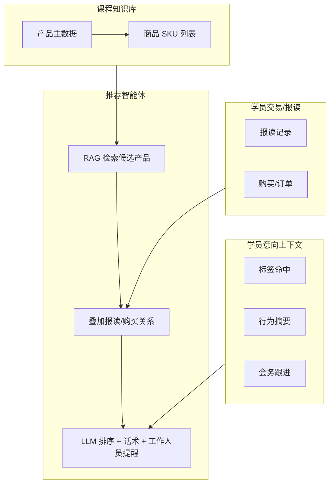

# 学员意向 · AI 课程产品推荐方案

> **版本：** v0.2（已确认业务规则）  
> **关联：** `CONFIRMATION.md`、会务 APP 原型、6Q 后台「学员意向分析」

---

## 1. 要解决什么问题

会务人员需要知道：对某学员应主推哪条 **课程产品线（产品）**，以及如何根据 **是否已报读/已购买** 调整沟通话术。  
一个 **产品** 下可有多个 **商品（SKU）**；推荐与展示均以 **产品** 为粒度，商品仅作参考列举。

---

## 2. 已确认业务规则（2025-05）

| # | 决策 | 说明 |
|---|------|------|
| 1 | **推荐产品，不推荐单一商品** | 知识库结构：`产品 → 商品[]`；智能体输出 `product_id` + 可选 `goods` 列表供参考 |
| 2 | **不因已报读/已购买而排除** | 已关联产品仍可进入推荐结果；必须在 UI 标注 **已报读 / 已购买 / 两者皆有**，并给出 **复训、使用资格** 等工作人员提醒 |
| 3 | **不允许人工改推荐结果** | 工作人员不能在手势端修改 AI 主推/备选排序；是否采纳、如何成交由人现场判断 |
| 4 | **不强制捆绑本期会务主题课** | 不推荐算法硬性插入「本期主题产品」；完全按标签/行为/跟进匹配 |

---

## 3. 数据模型

### 3.1 知识库 · 产品

```json
{
  "product_id": "prod_parent_talk",
  "product_name": "如何说孩子才会听",
  "series": "亲子沟通",
  "summary": "…",
  "retrain_note": "已报读学员复训政策…",
  "entitlement_note": "已购权益使用说明…",
  "goods": [
    { "sku_id": "sku_pt_adv_off", "name": "进阶班·线下3天2夜", "price": "8800", "form": "线下" }
  ]
}
```

### 3.2 学员 × 产品关系（订单/报读中心提供）

```json
{
  "product_id": "prod_parent_talk",
  "enrolled": true,
  "purchased": false,
  "sku_name": "本期现场·新训席位",
  "date": "2025-04"
}
```

### 3.3 推荐输出（智能体）

```json
{
  "primary": {
    "product_id": "prod_parent_talk",
    "product_name": "如何说孩子才会听",
    "match_percent": 92,
    "relation": {
      "status": "enrolled",
      "label": "已报读",
      "staff_reminder": "请围绕复训/升舱沟通…",
      "history_detail": "本期现场·新训席位（2025-04）"
    },
    "goods_price_range": "2,980 ~ 8,800",
    "reasons": ["…"],
    "pitch_one_liner": "…"
  },
  "alternatives": [ "…" ],
  "recommend_unit": "product"
}
```

**relation.status 枚举：** `none` | `enrolled` | `purchased` | `both`

---

## 4. 实现原理



| 环节 | 说明 |
|------|------|
| 检索 | 标签 + 行为 + 跟进 → 候选 **产品** Top-N |
| 关系注入 | 每个候选产品查询 `enrolled/purchased`，**不过滤**，写入 `staff_reminder` |
| 生成 | 输出主推/备选 **产品** + 沟通话术 + 复训/权益提示 |
| 缓存 | `conference_id + member_id`，与意向分析同生命周期刷新 |

---

## 5. 页面展示

| 端 | 展示 |
|----|------|
| APP 详情 | **AI 产品推荐**：主推产品卡 + 报读/购买状态条 + 商品列表（参考）+ 备选产品 |
| APP 列表 | 推荐产品名 + 匹配度 + 状态标签（已报读等） |
| APP 中控 | 本期高频 **推荐产品** TOP |
| 后台列表 | 列「推荐产品」+ 状态缩写 |
| 后台抽屉 | Tab「产品推荐」 |

---

## 6. 工作人员提醒文案逻辑

| 状态 | 标签 | 提醒方向 |
|------|------|----------|
| 未报读未购买 | — | 按新训/首购沟通 |
| 已报读 | 已报读 | 复训政策、下期席位、同产品其他商品差异 |
| 已购买 | 已购买 | 使用资格/有效期、是否升级商品 |
| 已报读+已购买 | 已报读·已购买 | 复训 + 权益核对，避免重复推销 |

产品级 `retrain_note` / `entitlement_note` 在已有关联时追加展示。

---

## 7. 接口草案（增补字段）

**GET** `.../course-recommend` 响应中：

- `recommend_unit`: `"product"`
- `primary.product_id` / `product_name`
- `primary.relation`（见上）
- `primary.goods[]`（可选，仅展示用）

**输入增补：** `member_product_history[]`（报读+购买合并）

---

## 8. 原型

`6q-conference-app-prototype/js/course-recommend.js` — 产品目录 + `PRODUCT_HISTORY_MOCK` + 规则打分。  
示例学员：**张志远 m10003**（已报读「如何说孩子才会听」）、**夏兰 m10001**（已购买线上年卡）。

---

## 9. 明确不做

- 不推荐到单一商品 SKU 作为主推  
- 不因已报读/已购买从列表剔除该产品  
- 不提供工作人员修改 AI 推荐排序/替换产品的功能  
- 不强制本期会务主题产品进入推荐
