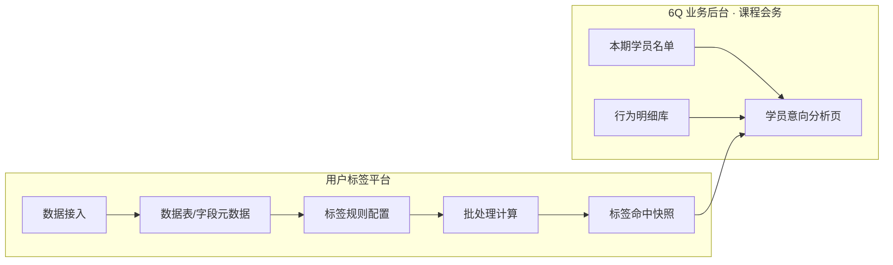
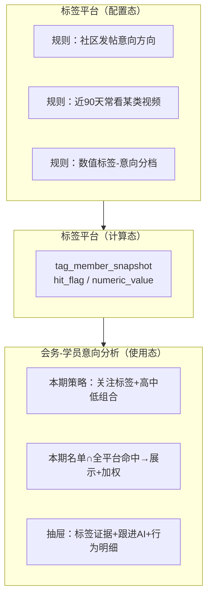
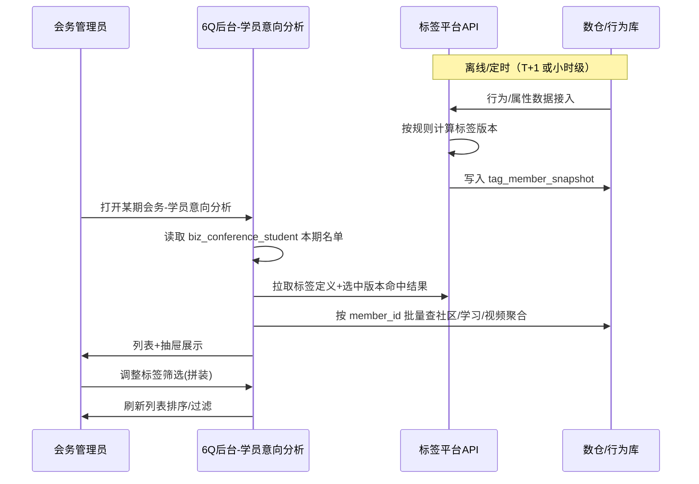

# 课程会务 · 学员意向分析（设计方案）

> 版本：v0.1 草案  
> 关联系统：用户标签平台（`user-tag-admin`）  
> 挂载位置：6Q 后台 → 计划与实施 → 线下课程会务 → **课程会务详情** → 左侧子菜单新增页

---

## 1. 背景与目标

### 1.1 业务背景

会务管理人员在某一期「课程会务」执行期间，需要了解**本期报读/参课学员**在历史行为与画像上的信号，用于：

- 识别 **高购买意向** 学员，安排跟进或会销触达；
- 理解学员 **意向课程方向**（如社区发帖、浏览内容）；
- 复盘 **过往学习产品** 与 **APP 内容消费** 是否与本期课程匹配。

### 1.2 产品目标

| 目标 | 说明 |
|------|------|
| G1 | 复用标签平台已配置的 **标签规则与命中结果**，不在会务侧重复造规则引擎 |
| G2 | 按 **本期会务学员名单** 聚合多维度行为数据，一屏可读 |
| G3 | 支持会务人员 **自选关注标签** 筛选；意向度 **按权重分或按命中标签二选一** 配置 |
| G4 | 为后续跟进动作（企微、电话、分组）预留扩展位 |

### 1.3 会务跟进（补充 · 已确认）

会务人员在 **跟进记录** 列表维护（与截图字段一致）：

| 字段 | 示例 |
|------|------|
| 跟进内容 | 学员今天找我了解了下关于 xxx 的课程 |
| 跟进标签 | 有意向用户（人工打标） |

**本期承载页需纳入：**

- 展示该学员在本期会务下的 **历史跟进记录**（内容、标签、跟进人、时间）；
- 通过 **AI 大模型** 对跟进内容做分析（摘要、意向课程方向、情绪/紧迫度等），在「学员意向分析」列表摘要与 360 抽屉中呈现；
- 与标签平台命中结果 **并列展示**，不替代人工跟进标签。

### 1.4 非目标（一期不做）

- 不在会务页新建/编辑标签规则（仍在标签平台完成）；
- 不做实时秒级画像（默认定时批处理 + 最近成功版本）；
- 不替代现有「学员信息 / 报读记录 / 跟进记录」主数据维护（跟进仍在原列表录入）。

---

## 2. 与用户标签系统的关系



| 标签平台能力 | 会务侧用法 |
|--------------|------------|
| 二级标签 + 规则 | 会务在标签平台**预先配置**规则；会务页仅**选用**标签，不重算规则 |
| **标签计算对象** | **全平台学员**（规则在平台配置，如「亲子视频>50分钟」）；会务只取 **本期名单 ∩ 平台命中快照** |
| 标签数据类型（布尔/数值/枚举） | 布尔/枚举→列表展示命中 chip；数值→参与 **2C 权重分**，原值在抽屉展示 |
| 执行版本（YYYYMMDD） | **不在会务业务页展示**；由标签平台/接口默认取最近成功版本 |
| 覆盖人数 / 上次成功版本 | 列表侧对齐标签平台口径 |
| 数据表 → 字段 | 规则在平台配置；会务侧消费 `tag_member_snapshot`（`member_id` = 平台学员 ID） |

### 2.1 标签下放模式（你已提出的方向 · 推荐）



**原则：** 会务侧 **不新建一套「分析规则」**；社区/学习/视频等维度，优先在标签平台做成标签后，在本页 **点击选用**。  
**4′B 并重：** 列表同时展示 **标签命中**、**意向度（高/中/低）** 与 **社区/学习/视频摘要**；标签用于筛选与意向分，行为摘要用于辅助判断；抽屉内保留各维度明细 Tab + 标签命中（含数值原值证据）+ 会务跟进。

**第 6 问 · 标签受众与本期用法：** 任一标签的 **计算范围 = 平台内全部学员用户**（例：「亲子意向」= 亲子类视频累计观看 >50 分钟的用户，由标签平台批处理产出快照）。会务页仅处理 **本期 `biz_conference_student` 名单**：若某学员在快照中命中该标签 → **列表展示该标签 chip**，且若该标签纳入本期 **关注/权重配置** → **累加 2C 全局权重分**。不在本期名单内的平台用户不出现在本页。

**意向度（二选一）：**
- **按权重分**：配置高/中/低总分下限；总分 = 标签权重 + AI 分（≤25）。
- **按命中标签**：为高/中/低各配标签组合（一级/二级树选）+ 任一/全部；判定顺序高 → 中 → 低。

---

## 3. 角色与使用场景

| 角色 | 场景 |
|------|------|
| 会务统筹 | 开课前排练高意向名单，分配跟进人 |
| 会销/跟进顾问 | 查看某学员社区帖、学过课程、常看视频 |
| 督导/导师 | 辅助判断学员是否匹配本期主题 |

**入口：** 课程会务详情 → 左侧子菜单 **「学员意向分析」**（建议名称，可改）。

---

## 4. 需求形态（页面概要）

### 4.1 信息架构

```
课程会务详情
├── 基础信息（已有）
├── 报读记录（已有）
├── 学员信息（已有）
├── …
└── 【新增】学员意向分析
    ├── 顶部：会务上下文 + 标签筛选器 + 汇总指标
    ├── 中部：学员列表（意向分/意向度/命中标签/关键行为摘要）
    └── 侧栏/抽屉：学员 360 明细（Tab）
         ├── 标签命中（标签平台）
         ├── 会务跟进（人工填写）
         ├── AI提炼分析（模型提炼 + AI 分）
         ├── 社区发帖
         ├── 学习记录
         └── 短视频浏览
```

### 4.2 页面线框（文字描述）

**A. 顶部筛选区**

- 会务只读信息：期数、课程产品、上课时间
- **关注标签**（筛选）：按标签平台 **一级 / 二级树** 多选，逻辑任一/全部；保存进本期策略（**B**）
- **意向度统计方式（二选一）**：**按权重分**（高/中/低总分阈值）或 **按命中标签**（高/中/低各配标签组合）；意向分列始终 = 标签权重 + AI 分（≤25）
- 汇总：本期学员数 / 命中任一关注标签人数 / **高意向学员人数**
- **不展示**标签快照版本选择（版本由平台侧消费，会务人员无需感知）

**B. 学员列表**

| 列 | 说明 |
|----|------|
| 学员 | 姓名、会员 ID、手机号脱敏 |
| 意向分 | **标签权重合计 + AI 权重分（≤25）** |
| **意向度** | 按本期配置的 **权重分阈值** 或 **命中标签组合**（二选一，见 `CONFIRMATION.md`） |
| 命中标签 | 本期学员在平台快照中命中的标签 chips（含关注标签与组合内标签） |
| 跟进内容 | 会务在「跟进记录」填写的原文（列表截断，悬停看全文） |
| **AI提炼分析** | 基于标签 + 跟进内容的模型提炼（短句展示，过长 tooltip） |
| 社区摘要 | 最近帖标题 + 提取的意向方向 |
| 学习摘要 | 近年课程数 / 最近课程名 |
| 视频摘要 | 常看分类 Top + 最近标题 |
| 操作 | 查看明细、跳转跟进记录（链已有页） |

**C. 学员明细抽屉**

四个 Tab，只读展示埋点聚合结果；支持导出单行 PDF/Excel（二期）。

### 4.3 与现有子菜单关系

- **学员信息**：主数据（报名态、分组等）
- **学员意向分析**：分析型只读视图，**不修改**学员主数据
- **跟进记录**：一期末尾「去跟进」跳转；二期可回写跟进结果

---

## 5. 数据模型（示例表 · 供你替换为真实库表）

> 以下表名为逻辑名，字段类型为建议，请对照实际数仓/业务库替换。

### 5.1 会务与学员

**`biz_conference`** — 课程会务主表

| 字段 | 类型 | 说明 |
|------|------|------|
| conference_id | bigint PK | 会务 ID |
| conference_no | varchar | 期数编号 |
| course_product_id | bigint | 课程产品 |
| start_time / end_time | datetime | 上课时间 |
| status | varchar | 报读中/待上课/进行中… |

**`biz_conference_student`** — 本期学员名单

| 字段 | 类型 | 说明 |
|------|------|------|
| id | bigint PK | |
| conference_id | bigint FK | 关联会务 |
| member_id | varchar | 平台学员 ID（与标签快照 `member_id` / `distinct_id` **同一主键**） |
| enroll_status | varchar | 报读/到课/退费 |
| created_at | datetime | 进入本期名单时间 |

### 5.2 标签平台（复用）

**`tag_definition`** — 标签定义（二级）

| 字段 | 类型 | 说明 |
|------|------|------|
| tag_code | varchar PK | 如 tag_1233 |
| tag_name | varchar | 亲子偏好 |
| parent_code | varchar | 一级分类 |
| data_type | varchar | 布尔/枚举… |
| status | varchar | 正常/停用 |

**`tag_compute_version`** — 计算版本

| 字段 | 类型 | 说明 |
|------|------|------|
| tag_code | varchar | |
| version_date | char(8) | YYYYMMDD |
| status | varchar | success/fail |
| cover_count | int | 覆盖人数 |

**`tag_member_snapshot`** — 学员标签快照（命中 + 可选数值）

| 字段 | 类型 | 说明 |
|------|------|------|
| tag_code | varchar | |
| version_date | char(8) | |
| member_id | varchar | |
| hit_flag | tinyint | 布尔/枚举类：1=命中 |
| numeric_value | decimal | **数值型标签**的计算结果（可空） |
| enum_value | varchar | 枚举类展示值（可空） |
| computed_at | datetime | |

### 5.3 行为明细（示例 · 多源）

**`dwd_community_post`** — 社区发帖

| 字段 | 类型 | 说明 |
|------|------|------|
| member_id | varchar | |
| post_id | varchar | |
| title | varchar | |
| content | text | |
| intent_course_tags | varchar | NLP/规则提取意向方向 |
| posted_at | datetime | |

**`dwd_learning_record`** — 学习记录

| 字段 | 类型 | 说明 |
|------|------|------|
| member_id | varchar | |
| course_product_id | bigint | |
| course_name | varchar | |
| finish_status | varchar | |
| last_learn_at | datetime | |

**`dwd_app_video_view`** — 短视频浏览

| 字段 | 类型 | 说明 |
|------|------|------|
| member_id | varchar | |
| video_id | varchar | |
| category_name | varchar | |
| title | varchar | |
| view_duration_sec | int | |
| viewed_at | datetime | |

### 5.4 会务侧配置（可选）

**`biz_conference_followup`** — 会务跟进记录（与现网列表一致，示例）

| 字段 | 类型 | 说明 |
|------|------|------|
| id | bigint PK | |
| conference_id | bigint | 会务 ID |
| member_id | varchar | 会员 ID |
| follow_type | varchar | 跟进类型 |
| follow_tags | varchar/json | 如：有意向用户 |
| follow_content | text | 跟进正文 |
| follow_images | json | 图片 URL 列表 |
| follower_name | varchar | 跟进人 |
| created_at | datetime | 创建时间 |

**`biz_followup_ai_insight`** — 跟进内容 AI 分析结果（异步写入）

| 字段 | 类型 | 说明 |
|------|------|------|
| followup_id | bigint PK/FK | 关联跟进记录 |
| summary | varchar | 一句话摘要 |
| intent_course | varchar | 提取意向课程/产品 |
| intent_level | varchar | 高/中/低（模型输出） |
| keywords | json | 关键词 |
| analyzed_at | datetime | 分析完成时间 |
| model_version | varchar | 模型版本 |

**`biz_conference_intent_config`** — 本期会务意向策略（**B + 7**，每期保存）

| 字段 | 类型 | 说明 |
|------|------|------|
| conference_id | bigint PK | |
| watch_tag_codes | json | **关注标签**（筛选列表、默认展示） |
| watch_tag_logic | varchar | any / all |
| score_mode | varchar | 一期 **2C**：全局固定权重，本期仅对「参与计分的标签」累加 |
| score_tag_codes | json | 参与意向分累加的标签（默认可=关注标签，可单独勾选） |
| threshold_high | int | 高意向 · 总分 ≥ |
| threshold_mid | int | 中意向 · 总分 ≥ |
| threshold_low | int | 低意向 · 总分 ≥ |
| updated_at / updated_by | | 保存人、时间 |

> 标签快照 `version_date` 由服务端对接标签平台时取**最近成功版本**，不入会务 UI。

**意向总分：**

```
意向总分 = Σ(命中标签的全局 tag_weight) + AI权重分
AI权重分 ∈ [0, 25]，由模型根据「命中标签 + 本期跟进内容」评估
```

**意向度（按期分值阈值）：**

```
若 总分 ≥ threshold_high → 高
否则若 总分 ≥ threshold_mid → 中
否则若 总分 ≥ threshold_low → 低
否则 → 未分级
```

**AI提炼分析：** 跟进正文由会务维护；`biz_followup_ai_insight` 存短摘要（列表）与完整分析（抽屉 / tooltip），与跟进列表分列展示。

**标签时效（已确认）：** 会务页 **不设默认近 90 天** 等行为截断。学员是否命中某标签，以标签平台 **当前选用版本** 的 `tag_member_snapshot` 为准：规则在平台侧定义时间范围；一旦计算写入且未重算，则在该版本下 **持续视为命中**，直至管理员在标签平台 **重新计算** 该标签并产生新版本。会务侧只读消费快照，不自行过期。行为明细 Tab（社区/学习/视频）与标签并重展示时，**不额外加会务级时间窗**；若需看规则口径，见标签平台规则说明或抽屉内标签证据。

---

## 6. 数据流转图



**意向分计算（建议）：**

```
意向分 = Σ(命中标签权重) + 可选行为加分
过滤：仅统计本期 biz_conference_student 内学员
```

---

## 7. 接口概要（示例）

| 接口 | 方法 | 说明 |
|------|------|------|
| `/conference/{id}/intent/overview` | GET | 汇总 + 默认标签配置 |
| `/conference/{id}/intent/students` | GET | 分页列表（标签筛选、排序） |
| `/conference/{id}/intent/students/{memberId}` | GET | 学员 360 明细 |
| `/tags/definitions` | GET | 复用标签平台，二级+正常状态 |

---

## 8. 分期建议

| 阶段 | 范围 |
|------|------|
| P0 | 新菜单页 + 树形关注标签 + 分值阈值 + 跟进/AI分列 + 360 抽屉 |
| P1 | 意向分权重配置、导出、跳转跟进记录 |
| P2 | 跟进回写、企微触达、与分组/座位联动 |

---

## 9. Grill 确认记录

| 项 | 结论 |
|----|------|
| 标签拼装 | **B** 保存为本期会务策略 |
| 意向分一期 | **2C** 全局固定权重，本期只选标签 |
| 会务跟进 + AI | 纳入承载页；AI 分析跟进内容 |
| AI 触发 | **3C** 保存后异步实时分析 + 支持手动「重新分析」 |
| 数据主路径 | **4′B** 标签与行为明细并重（列表同时展示；标签选用 + 行为摘要并存） |
| 标签计算范围 | **6** 面向**全平台学员**；会务=本期名单∩命中快照；命中则展示 chip + 可加权 |
| 学员 ID | **6** `member_id` 与平台学员主键一致，直接 join 快照 |
| 意向度定义 | **二选一**：按权重分阈值 **或** 按命中标签组合（见 `CONFIRMATION.md`） |
| AI 展示 | 独立列/Tab「AI提炼分析」；跟进列仅人工内容 |
| 标签选择 | 关注标签按平台 **一级/二级树** 选择 |
| 标签时效 | **不设会务默认 90 天**；命中以平台快照为准，持续有效直至标签 **重新计算** 出新版本 |
| 高/中/低组合 | **允许** 同一 `tag_code` 出现在多档；展示意向度时仍按 **高 > 中 > 低** 优先 |

---

## 10. Grill 收尾（已全部确认）

- ~~行为明细默认 90 天~~ → **不需要**；标签命中跟平台版本与重算节奏走。
- ~~组合互斥~~ → **允许重复标签**；判定优先级不变。

---

*详设见上文 · **方案确认稿：** `CONFIRMATION.md` · 原型：`6q-conference-prototype/`*
