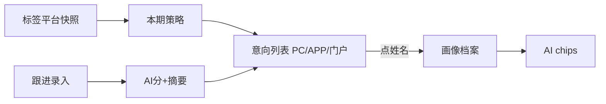

# 学员导购 / 意向分析 · 开发交接 Handoff

> **交付范围：** v1.0.0 → v1.0.3（一次开发）  
> **日期：** 2026-08-24  
> **对象：** 研发 / 测试  
> **原型仓库：** `xingfu362546/6Q-user-conference`  
> **套件入口：** [`6q-intent-suite/index.html`](../../6q-intent-suite/index.html)（功能清单总页）  
> **阅读顺序：** 本文清单 → 打开对应原型页右下角**红点注释** → 详设文档

---

## 0. 怎么用这份交接

| 步骤 | 做什么 |
|------|--------|
| 1 | 按下方「开发清单」勾选模块；每条附 **逻辑注释** + **原型路径** + **页内注释 ID** |
| 2 | 浏览器打开原型页，点右下角红色序号看规则 / 流程图 / 操作案例 |
| 3 | 长文规则只读引用文档，勿在代码里另造口径 |
| 4 | 埋点另表：`学员导购埋点方案.xlsx`（桌面副本同名） |

### 总入口

| 用途 | 路径 |
|------|------|
| 三端/四端功能清单（含注释正文） | [`6q-intent-suite/index.html`](../../6q-intent-suite/index.html) + [`index-features.js`](../../6q-intent-suite/index-features.js) |
| 会务后台版本导航 | [`6q-intent-suite/6q-conference-prototype/versions.html`](../../6q-intent-suite/6q-conference-prototype/versions.html) |
| 功能变更 changelog | [`FEATURE-CHANGELOG.md`](../../6q-intent-suite/6q-conference-prototype/docs/FEATURE-CHANGELOG.md) |
| 产品方案 | [`CONFIRMATION.md`](./CONFIRMATION.md) |
| 课程推荐规则 | [`COURSE-RECOMMENDATION.md`](./COURSE-RECOMMENDATION.md) |
| 策略配置说明 | [`INTENT-STRATEGY-CONFIG.md`](./INTENT-STRATEGY-CONFIG.md) |
| 标签 NL→SQL（v1.1） | [`HANDOFF-v1.1.md`](./HANDOFF-v1.1.md) · `6q-intent-suite/user-tag-admin/LOGIC_ALIGNMENT.md` |
| 页→注释映射 | [`shared/intent-proto-pages.js`](../../6q-intent-suite/shared/intent-proto-pages.js) |

### 页内注释覆盖（交付前已核对）

| 端 | 页面 | 注释 |
|----|------|------|
| 标签 | `tag-list/create/history` · `data-access/tables` | ✅ |
| 会务后台 | 策略模板/编辑 · 本期策略 · 意向分析 · 跟进 · **学员信息** · **画像档案** | ✅（后两者本次补挂） |
| 会务 APP | 学员列表 · 运营详情 · 跟进编辑 · 扫描 · 中控 · 意向列表 · 详情 | ✅ |
| 面谈官门户 | **登录** · **选会务** · **意向** · **画像** | ✅（本次补挂） |

> 打开页后应看到右下角红点 dock；若无，检查 Network 里 `index-features.js` / `intent-proto-*.js` 是否 200。

---

## 1. 版本地图（一次交付）

| 版本 | 主题 | 必做端 |
|------|------|--------|
| **v1.0.0** | 策略模板 + 本期策略 + 学员意向分析列表/抽屉 | 标签消费 + 会务后台 + APP 意向链路 |
| **v1.0.1** | 学员信息入口 + 画像档案三栏首版 | 会务后台 |
| **v1.0.2** | 画像增强（家庭组/关系图/行为跟进抽屉/AI chips）；意向列表精简 | 会务后台（APP 跟随后台口径） |
| **v1.0.3** | 面谈官独立 PC 门户（只读） | `6q-interviewer-portal/` |

---

## 2. 核心逻辑（全版本共用 · 开发必懂）

### 2.1 主键与边界

| 规则 | 逻辑注释 |
|------|----------|
| 主键 | `member_id` 全链路直连，**不做映射表**（注释 #12） |
| 标签计算 | 全平台批处理 → `tag_member_snapshot`；会务只取 **本期名单 ∩ 命中**（#1） |
| 会务不配标签规则 | 规则/权重在标签平台；会务只选用关注标签 + 意向度方式（#15–18） |
| 未配置策略 | 意向页**禁止**静默默认出数；空态引导去「本期分析策略」（#20） |
| 一期不做 | 会务改标签规则、秒级画像、人工改 AI 推荐、展示快照版本号（#40） |

### 2.2 意向分与意向度

| 概念 | 公式 / 规则 | 注释 |
|------|-------------|------|
| 意向分 | `Σ(命中标签平台权重) + AI分(0~25)`；加总**不限**关注标签子集 | #22 |
| 意向度 A | 三阈值：高→中→低→未分级 | #17 |
| 意向度 B | 高/中/低标签组合；允许多档命中取最高；**不用**分数切档 | #18 |
| 关注标签 | 仅筛列表是否出现；**不改**分、不改平台命中 | #15 |

### 2.3 策略保存副作用

保存「本期策略并重算」→ `intent_strategy_version++` → PC 列表重算 → APP **强制重跑**分析动效（#19、#32）。

### 2.4 跟进与 AI 洞察

- 录入：会务「跟进记录」菜单；范围 = **本期会务 × 该学员**（#25、#31）
- 保存后异步 AI → 写 insight → 列表「AI 提炼」列 + 计入意向分
- **v1.0.2 起**：列表列名「跟进内容（当前会务）」；跨会务历史跟进在**画像抽屉**

### 2.5 课程推荐（产品级）

见 `COURSE-RECOMMENDATION.md`（注释 #38）：推荐**产品**不推荐单 SKU；已报读/已购不排除但必须标注；**不可**人工改排序；不强制插本期主题课。

### 2.6 画像 AI chips（v1.0.2/v1.0.3）

| Chip | 逻辑 |
|------|------|
| 分析跟进 | 跨会务跟进全量归纳 |
| 沟通话术 | 标签/跟进/购课 → 开场+追问 |
| 近期消费能力 | 近 12 月已支付粗估：`&lt;5000` / `5000–20000` / `≥20000` |
| 课程购买建议 | 按消费力分档建议路径（低档偏免费直播·社区·免费课；高档可谈高客单）；**不绑定**意向推荐课 |

实现参考：`6q-conference-prototype/js/conference-profile-ai-chat.js`（注释 #47）

---

## 3. 开发清单（按端 · 含逻辑注释）

勾选即开发范围。`注#n` = `index-features.js` 中 notes 编号。

### A. 用户标签平台（依赖层 · 与导购联调）

| # | 模块 | 原型 | 逻辑注释 | 注 |
|---|------|------|----------|----|
| A1 | 标签列表运维 | `user-tag-admin/tag-list.html` | 一级预置不可新建；二级运维；覆盖人数=上次成功版本 | #1–4 |
| A2 | NL→SQL 圈选 | `tag-create.html` | 生成→解读/预估→确认计算；例行复用已确认 SQL；可视化规则一期不做 | #5–8 |
| A3 | 执行历史 | `tag-history.html` | 本版本无效；Tab：命中用户｜本次 SQL | #9 |
| A4 | 数据资产 | `data-access.html` / `data-tables.html` | 接入只读；表字段只读 | #10–11 |
| A5 | 全局权重 | 标签编辑 | 供意向分 Σ；会务不可改 | #7 |

### B. 会务后台 · v1.0.0 基线

| # | 模块 | 原型 | 逻辑注释 | 注 |
|---|------|------|----------|----|
| B1 | 分析策略模板列表 | `tools-intent-strategy-template.html` | 会务工具、与期次无关；统筹角色增删改 | #13–14 |
| B2 | 编辑模板 | `tools-intent-strategy-template-edit.html` | 关注标签（任一/全部）+ 意向度 A/B 二选一完整 JSON | #15–18 |
| B3 | 本期分析策略 | `conference-intent-strategy.html` | 选用模板 / 复制上期 / 保存并重算 version++ | #19、#32 |
| B4 | 学员意向分析列表 | `conference-student-intent.html` | 未配置空态；只读策略摘要；默认按意向分降序 | #20–24、#26、#28 |
| B5 | 明细抽屉 | 同上 | v1.0.0 含标签+洞察；**以 v1.0.2 精简后为准交付** | #29 |
| B6 | 跟进录入触发 AI | `conference-detail-basic.html` | 保存异步分析 | #25、#31 |

### C. 会务后台 · v1.0.1

| # | 模块 | 原型 | 逻辑注释 | 注 |
|---|------|------|----------|----|
| C1 | 学员信息入口 | `conference-students.html` | 子导航启用；操作列「画像档案」 | #41 |
| C2 | 画像档案三栏 | `conference-student-profile.html` | 左标签 / 中购课复购 / 右跟进退款行为；全局档案+会务上下文 | #41 |
| C3 | 购课/复购/退款 | 同上 | 按课程产品计次；同产品≥2=复购；退款订单字段 | #41 |
| C4 | 基础图表 | 同上 | 购课条形 + 近30天行为折线（环图后被 v1.0.2 替换） | #41 |

### D. 会务后台 · v1.0.2（交付以本版列表/档案为准）

| # | 模块 | 原型 | 逻辑注释 | 注 |
|---|------|------|----------|----|
| D1 | 家庭组 | 画像中栏 | 家庭 ID + 成员表，高亮本人 | #42 |
| D2 | 关系图谱 | 画像右栏 | 推荐/归属双边、1 跳、当前生效；环形交互（ECharts） | #42 |
| D3 | 基础信息补齐 | 画像 | 对齐会员详情：身份/关系人/认证/社会属性 | #43 |
| D4 | 近期行为四 Tab | 画像 | 社区/学习/视频/直播；预览 5 条 + 查看更多抽屉全量 | #27、#45 |
| D5 | 跟进查看更多 | 画像 | 跨会务历史；承接原意向抽屉「历史跟进」 | #45 |
| D6 | AI 对话 chips | 画像 | 见 §2.6 | #47 |
| D7 | 意向列表精简 | `conference-student-intent.html` | 删行为四列与抽屉行为/历史跟进 Tab；列名「跟进内容（当前会务）」；点姓名→画像 | #25、#27、#29 |
| D8 | 抽屉终态 | 同上 | 仅「标签命中」+「洞察与推荐」 | #29 |

### E. 会务 APP · 现场执行（随 v1.0.0+）

| # | 模块 | 原型 | 逻辑注释 | 注 |
|---|------|------|----------|----|
| E1 | 学员列表入口 | `app-students.html` | AI 意向洞察横幅；同源 member_id | #33 |
| E2 | 运营详情 / 跟进编辑 | `app-student-ops-detail.html` · `app-student-follow-edit.html` | 本场跟进、购课意向标注 | #33、#25 |
| E3 | AI 分析动效 | `app-intent-scan.html` | 策略版本不一致强制重扫 | #34、#32 |
| E4 | 意向中控 | `app-intent-dashboard.html` | 环图分布 + KPI + TOP3；点档位下钻 | #35 |
| E5 | 意向学员列表 | `app-intent-list.html` | 高/中/低 Tab | #36 |
| E6 | 学员意向详情 | `app-student-detail.html` | 意向块 + 跟进只读 + 产品推荐（不可改） | #37–38 |

### F. 面谈官门户 · v1.0.3

| # | 模块 | 原型 | 逻辑注释 | 注 |
|---|------|------|----------|----|
| F1 | 登录 | `6q-interviewer-portal/login.html` | 手机或邮箱 + 密码 + 图形验证码；账号=会员体系 | #46 |
| F2 | 选择会务 | `conference-select.html` | 仅**进行中**且本人为面谈官；空态文案固定 | #46 |
| F3 | 只读意向列表 | `student-intent.html` | 呈现对齐后台；**无**策略配置/导出/跟进入录 | #46、#29 |
| F4 | 明细抽屉 | 同上 | 标签命中 + 洞察与推荐 | #29 |
| F5 | 画像 + AI | `student-profile.html` | 复用后台档案 JS；隐藏发起跟进 | #46、#47 |

**权限注释：** 角色来自会务内「面谈官」赋权；可看该期**全部学员**；不能进运营后台。

---

## 4. 建议研发拆分顺序

1. **标签快照 API + member_id 联调**（A）  
2. **策略模板 / 本期策略 / 意向分·度计算引擎**（B1–B4）  
3. **跟进 → AI insight**（B6）  
4. **APP 中控链路 + version 重扫**（E）  
5. **画像档案 + 行为/跟进抽屉**（C→D）  
6. **意向列表按 v1.0.2 精简 + 姓名跳转**（D7–D8）  
7. **面谈官门户鉴权 + 只读复用**（F）  
8. **埋点：路径定时 + 点击**（见埋点表）

---

## 5. 验收要点（抽测）

| 场景 | 期望 |
|------|------|
| 本期未保存策略 | PC/APP/门户不出静默默认分档 |
| 保存策略后开 APP | 必经分析动效（版本变） |
| 意向列表点姓名 | 进画像顶部落地，带 member_id |
| 画像行为「查看更多」 | 四 Tab 全量；意向列表无行为列 |
| 推荐已购产品 | 有状态标+工作人员提醒；UI 不能改序 |
| 门户无会务账号 | 「当前无正在进行中的会务」 |
| 门户 | 无策略入口、无导出、无跟进按钮 |

原型免校验账号：门户可直接登录；`13900002222` 验无会务空态。

---

## 6. 明确不在本期

- 标签可视化规则器恢复（NL→SQL 一期）
- 会务页编辑标签/权重
- 人工修改 AI 推荐结果
- 意向列表导出 Excel（占位）
- 面谈官写跟进 / 配策略
- 正式商机诊断条（画像 AI 仅为事实+轻建议）

---

## 7. 下一会话建议

1. 按 §3 清单建研发任务 / Issue（可用 `to-issues`）  
2. 埋点表与前端事件 ID 对齐联调  
3. 真 AI：跟进洞察 + 画像 chips + 课程推荐接口替换 mock  

### 建议技能

- 拆 Issue：`to-issues`  
- 口径争议：`grill-me` + 本文 §2  
- 推远程：先确认 GitHub `origin` vs CodeUp `codeup`

### Mem0 检索关键词

`testProject 学员导购 handoff v1.0.3` · `意向分析 开发清单`

---

## 8. 变更记录

| 日期 | 说明 |
|------|------|
| 2026-08-24 | 首版开发交接：覆盖 v1.0.0–v1.0.3；补挂画像/学员信息/门户页内注释；新增注 #47 AI chips |
