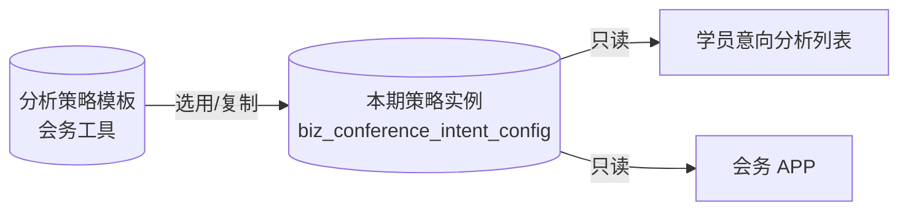

# 意向分析策略 · 配置拆分设计（已确认）

> **版本：** v1.0  
> **确认日期：** 2025-05

---

## 1. 确认结论汇总

| # | 你的确认 |
|---|----------|
| 1 | **关注标签 + 意向度** 一起从分析列表搬走 |
| 2 | **每一期会务一套** 策略实例（`biz_conference_intent_config`） |
| 3 | 需要 **复制上期**；规则本体在 **会务工具 · 分析策略模板** 统一维护 |
| 4 | **特定系统角色** 可配置（如会务统筹） |
| 5 | 未配置 → **引导去配置**，不用静默默认 |
| 6 | 分析页 **只读展示** 策略摘要，不可编辑 |
| 7 | 保存后 **立即重算** 列表/指标 |
| 8 | 取消「应用筛选」— **保存即生效**（见 §3 说明） |
| 9 | APP 策略变更后 **自动重新跑分析动效** |

---

## 2. 关于「应用筛选」（第 8 点说明）

原 prototype 在左侧配置区有一个 **「应用筛选」** 按钮：只临时按关注标签筛列表，**不保存**策略。

**新方案：** 去掉该按钮。关注标签写入本期策略后，与意向度规则 **一并保存**，保存后 **立即生效并重算**，不再需要「先改再点应用」的两步操作。

---

## 3. 菜单与页面结构

### 3.1 会务工具（全局 · 模板）

```
会务工具
└── 分析策略模板          ← 新建（tools-intent-strategy-template.html）
    ├── 模板列表
    └── 编辑模板（关注标签 + 意向度二选一）
```

- **谁用：** 会务统筹 / 有配置角色的运营  
- **存什么：** 可复用模板（名称、说明、完整策略 JSON）  
- **命名：** 菜单 **「分析策略模板」**（比「策略配置」更明确是模板层）

### 3.2 课程会务详情（某一期）

```
课程会务详情
├── …
├── 本期分析策略          ← 新建（conference-intent-strategy.html）
│     · 选用模板 / 复制上期
│     · 保存本期策略 → 立即重算
└── 学员意向分析          ← 精简为只读分析 + 列表
      · 策略摘要条（只读）
      · 搜索 + 列表 + 抽屉
```

### 3.3 权限（建议）

| 页面 | 无配置角色 | 有配置角色 |
|------|------------|------------|
| 分析策略模板 | 不可见或只读 | 增删改模板 |
| 本期分析策略 | 不可见 | 选用模板、保存 |
| 学员意向分析 | 可看列表 | 可看列表 |

---

## 4. 数据模型



| 实体 | 存储 | 说明 |
|------|------|------|
| `intent_strategy_template` | 全局 | 模板 ID、名称、config JSON |
| `biz_conference_intent_config` | 每期会务 | 来自模板快照 + 保存时间 + 模板引用 |
| `intent_strategy_version` | 每期 | 保存递增，APP 用来触发重新分析 |

---

## 5. 保存与重算

保存本期策略时服务端（原型为 localStorage）：

1. 写入 `biz_conference_intent_config`  
2. `intent_strategy_version++`  
3. 重算本期学员意向分/意向度/列表 KPI  
4. 异步刷新 AI 提炼 & 产品推荐（若已接入）  
5. APP 下次进入意向流程时 **清除已分析缓存 → 重新跑分析动效**

---

## 6. 原型路径

| 页面 | 路径 |
|------|------|
| 分析策略模板列表 | `6q-conference-prototype/tools-intent-strategy-template.html` |
| 编辑模板 | `6q-conference-prototype/tools-intent-strategy-template-edit.html` |
| 本期分析策略 | `6q-conference-prototype/conference-intent-strategy.html` |
| 学员意向分析（只读） | `6q-conference-prototype/conference-student-intent.html` |

---

## 7. 与 CONFIRMATION 的关系

原 §5「配置 + 列表同页」改为 **三页分离**：模板 / 本期选用 / 分析只读。  
核心规则（意向分公式、意向度二选一、关注标签）不变，见 `CONFIRMATION.md` §4。
