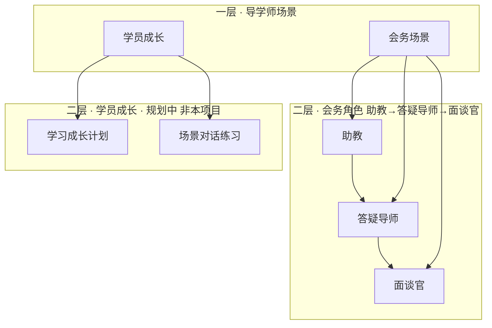
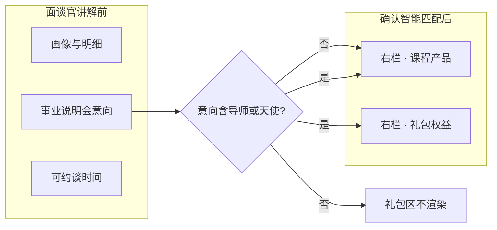

# 导学师场景结构

> 名称：**《导学师场景结构》**  
> 日期：2026-08-31  
> 范围：会务三角色（助教 → 答疑导师 → 面谈官）承接本项目「导购 / 意向分析」已定稿意图；学员成长二层仅占位。  
> 关联：分析助手原型、Dify 8 类分类器、事业说明会意向登记（图1）、礼包权益目录（图2）

---

## 0. 怎么读这张图

- **一层**是场景：人在什么场干活。
- **二层**是岗位或能力包：会务拆角色，学员成长拆产品模块。
- **三层**只展开会务三角色：每个角色要接哪些意图、助手能辅助什么、不能越权做什么。
- 角色是**升级关系**，不是三个并列客服：助教处理会务基础与浅介绍 → 答疑导师处理更深个人疑惑 → 面谈官按课中/课后登记的面谈意向约讲解，讲解前必须看画像与明细。

---

## 1. 一层

| 场景 | 定义 | 本项目是否落地 |
|------|------|----------------|
| **会务场景** | 某一期线下/线上课程会务执行期内，工作人员围绕**当期学员**做服务、答疑、意向登记与约谈讲解。 | **是。** 导购与意向分析、画像助手、面谈官门户都挂在这里。 |
| **学员成长** | 会务结束后的长期学习陪伴：计划、练习、复盘。 | **否。** 二层仅占位，不把本期意图硬塞进去。 |

---

## 2. 二层

### 2.1 会务场景 · 三角色（层级）

| 角色 | 在层级中的位置 | 职责边界 |
|------|----------------|----------|
| **助教** | 第一层服务 | 会务过程中的基础服务（签到、座位、小组、课间、找人）；**简单课程介绍**（课名叫什么、今天讲哪一阶、去哪看期数）。不承担深度个人疑惑，不承担约谈成交讲解。 |
| **答疑导师** | 中间层 | 课中/课后**更深的问题**或**个人疑惑**（为什么适合我、和上一阶差在哪、家里这种情况怎么理解）。可以给课程方向建议，**不替代面谈官约谈**。 |
| **面谈官** | 最高层 | 依据课中或课后在**事业说明会**登记的面谈意向，预约学员做讲解。讲解前必须掌握**用户画像和详细信息**（标签、行为、跟进、报读、小组/助教、可约谈时间、意向了解方向）。可同时讲**课程产品**与符合条件的**礼包权益**。 |

升级规则（现场）：

1. 会务后勤、找座位、今日流程、一句话课名 → **助教**。
2. 个人情况、课阶差异、适不适合自己、心里顾虑 → **答疑导师**。
3. 已登记要了解导师 / 天使 / 体系课，需要完整讲解与方案 → **面谈官**。

### 2.2 学员成长 · 占位

| 模块 | 说明 | 本期 |
|------|------|------|
| 学习成长计划 | 按学员课阶与目标排学习节奏 | 规划中，无意图赋能 |
| 场景对话练习 | 家庭/沟通场景的练习与反馈 | 规划中，无意图赋能 |

---

## 3. 三层 · 会务三角色意图与辅助点

已定稿意图来自两处，赋能时**按角色裁剪**，不是每人全开成交能力。

**分类器 8 类（Dify）**

| 枚举 | 中文 | 工作人员在问什么 |
|------|------|------------------|
| `interest` | 兴趣解读 | 学员对什么课感兴趣、标签/行为说明了什么 |
| `followup` | 下一步跟进 | 按层级与报读，下一步怎么跟 |
| `product_prepare` | 产品匹配准备 | 适合什么课程产品，但尚未下令匹配 |
| `product_match` | 智能匹配 | 确认按当前条件开始匹配 |
| `product_detail` | 产品细节 | 某课介绍 / 课务 / 商品（浅或深由角色决定） |
| `city_sessions` | 城市期数 | 某城最近开课、某站还有没有 |
| `mentor_courses` | 导师相关 | 某导师有哪些课/档期 |
| `other` | 其他 | 拉回助手职责；含尚未单开的课阶对比时可走演示检索 |

**助手演示另册（与分类器对齐，不另造一套）**

- 课阶区别 `level_diff`（一阶/二阶、沙龙/分享会）
- **礼包权益** `gift_packages`（新）：与课程产品分区；**不是**新的口头分类，而是智能匹配时的**旁路数据源**

**礼包规则（图1 → 图2）**

| 项 | 约定 |
|----|------|
| 数据源 | 事业说明会名单 **意向了解方向**（图1）：`导师` / `天使` / `导师&天使` |
| 推荐什么 | **礼包权益**目录（图2）：高EQ导师进阶版 A/B、一级/二级传播天使进阶报读等；升级方式多为首次升级购买；与课程 SKU **分区** |
| 谁触发 | 面谈官讲解与分析助手**确认匹配之后**的右栏 |
| 隐藏 | 意向为空、无、—、或不含「导师」「天使」→ **整块礼包区域不展示**（不是空列表占位） |
| 预算 | 礼包不走本次**课程预算**门槛（客单价 4～5 万，与 5 千内课程预算不是同一硬门槛） |

演示学员（与原型一致）：

| 学员 | 意向了解方向 | 可约谈讲解时间 | 礼包区 |
|------|----------------|----------------|--------|
| 项琳琳 | 天使 | 课程结束后 | 展示 |
| 夏兰 | （空） | 课间休息时 | **隐藏** |
| 张志远 | 导师&天使 | 随时都可以 | 展示 |

会务后台 / 面谈官门户 / APP 意向列表与抽屉**同源闸门**（课一行，有方向才礼包一行）；演示对照：陈晓明天使、赵雅琴导师、张志远导师&天使；李美琳 / 王建国 / 刘慧敏方向空。**本期不改分析助手**（项琳琳 / 夏兰 / 张志远对照维持现状）。

---

### 3.1 助教 · 全部意图与辅助点

定位：会务基础服务 + 浅介绍。助手帮**查事实、挡越权**，不帮成交。

| 意图 | 是否赋能 | 助手辅助什么 | 明确不辅助 |
|------|----------|--------------|------------|
| 会务基础问答（本层补：签到号、小组、座位、助教是谁、课间/课后流程） | **主责** | 读当期名单：小组、助教、签到、资格（新训/复训）、复训次数 | 不改座位、不改分组 |
| `city_sessions` 城市期数 | 浅 | 「本期/本城还有没有课」用课务接口口径回答；无接口则声明不能编期数 | 不替学员锁名额 |
| `product_detail` 产品细节 | **浅** | 课名、课阶名称、一句话介绍 | 不展开大纲成交、不报价谈判 |
| `mentor_courses` | 浅转介 | 只回答「这期授课老师是谁」；复杂档期交给答疑导师/面谈官 | 不按导师做销售匹配 |
| `interest` / `followup` | 不主责 | 听到兴趣信号 → 记录并升级给答疑导师 | 不解读整份画像 |
| `product_prepare` / `product_match` | 不开放 | — | 不开右栏匹配 |
| 礼包权益 | 不开放 | 若学员口中出现「想当导师/天使」→ **登记意向并升级面谈官** | 不讲礼包成交方案 |
| `other` | 纠偏 | 「这是助教能答的范围，深度问题请答疑导师」 | 不给成交话术 |

辅助清单（助教打开助手时优先看到）：

1. 当前学员：签到号、6Q 姓名、真实姓名、会员 ID、手机、小组、助教。
2. 今日会务：资格、复训次数、可约谈时间是否已填（填了则提示交给面谈官）。
3. 浅介绍：当期课程产品类型（沙龙 / 分享会 / 一阶…）一句话。

---

### 3.2 答疑导师 · 全部意图与辅助点

定位：深入问题与个人疑惑。可以做分析与方向建议，**约谈讲解仍归面谈官**。

| 意图 | 是否赋能 | 助手辅助什么 | 明确不辅助 |
|------|----------|--------------|------------|
| `interest` 兴趣解读 | **主责** | 标签 + 行为埋点；区分事实与推断 | 不编学员没产生过的浏览 |
| `followup` 下一步跟进 | **主责** | 上课层级 vs 报读取最高有效层级；下一跳（有分享会→一阶，仅沙龙→分享会） | 不虚构更高课阶 |
| `product_prepare` | 开放 | 抽槽：方向 / 城市 / 预算 / 层级；问是否需要面谈官匹配 | 不擅自 `confirm_match` |
| `product_detail` | **深** | 课程介绍、大纲级说明、课阶区别；可不绑学员（介绍类） | 不编当期价格/名额 |
| `level_diff` 课阶区别 | **主责** | 沙龙→分享会→一阶→二阶顺序；不写营销「定位」文案 | 不把类型词误判成兴趣 |
| `city_sessions` | 开放 | 城市 × 近期期数；无 HTTP 则声明缺失 | 不编造南宁/广州档期 |
| `mentor_courses` | 开放 | 导师课单与档期检索口径 | 同上 |
| `product_match` | 可建议、默认不执行 | 「条件已齐，建议转面谈官确认匹配」 | 除非授权，否则右栏仍空 |
| 礼包权益 | **转介** | 若图1已有导师/天使意向，提示「该学员已登记事业意向，深度讲解请面谈官」 | 不打开礼包成交区 |
| 画像明细 | 只读摘要 | 跟进记录、报读历史，用于解答个人疑惑 | 不修改档案 |
| `other` | 纠偏 | 拉回答疑，不写成交话术 | — |

辅助清单（答疑导师）：

1. 兴趣结论 + 依据（标签 / 浏览 / 视频 / 直播 / 社区）。
2. 层级冲突时的核对（标签写沙龙、报读已到分享会 → 以报读为准）。
3. 个人疑惑对应的课阶/课程介绍（知识库原文，不绑学员也要能答）。
4. 是否已有面谈意向、可约谈时间——有则升级，不截胡约谈。

---

### 3.3 面谈官 · 全部意图与辅助点

定位：按**已登记面谈意向**约讲解。讲解前先看画像和细节。本项目分析助手的完整能力挂在此角色（会务后台工作人员若代行讲解，权限等同）。

| 意图 | 是否赋能 | 助手辅助什么 | 明确不辅助 |
|------|----------|--------------|------------|
| **画像 briefing（本层补）** | **主责 · 讲解前必做** | 一屏：身份、小组、助教、资格/复训次数、标签、行为、跟进、报读/购买、**意向了解方向**、**可约谈讲解时间** | 不在助手里改档案 |
| `interest` | 开放 | 同答疑导师，用于开场对齐「你关注什么」 | — |
| `followup` | 开放 | 下一跳课阶 + 是否复训 | — |
| `product_prepare` | **主责** | 条件卡：显式 / 推断 / 缺失；询问是否确认匹配 | 未确认不开右栏 |
| `product_match` | **主责** | 课程产品 TOP 主推+备选；课务 3 期；SKU 与课程预算硬校验 | 不落单、不加购、不复制成交话术 |
| **礼包权益** | **主责 · 旁路** | 读图1 意向了解方向；含导师或天使 → 右栏**第二区**推荐图2 礼包（名称/升级方式/类型/级别/价格/定金分期）；**与课程产品分区** | 意向空则**整区隐藏**；礼包不套用课程预算 |
| `product_detail` | 开放 | 主推课介绍、近期课务与商品；礼包点开看礼包属性 | 右栏不因追问自动跳转（沿用现规则） |
| `city_sessions` / `mentor_courses` / `level_diff` | 开放 | 同课务检索演示 | 无接口不编造 |
| 约谈安排 | **主责** | 展示并提醒「可约谈讲解时间」：课程结束后 / 随时都可以 / 课间休息时 | 助手不代替日历邀约系统 |
| `other` | 纠偏 | 分析与参考，不写去成交的话术 | — |

讲解前核对清单（面谈官）：

1. 是谁：6Q 姓名、真实姓名、会员 ID、手机、城市。
2. 会务位：签到号、小组、助教、新训/复训、复训次数。
3. 学习位：上课层级、报读/购买、资格是否核销。
4. 意向位：意向了解方向、可约谈时间、跟进里说过的预算与城市偏好。
5. 方案位：课程产品匹配结果；若意向含导师/天使，再看礼包权益区。

---

## 4. 意图 × 角色总表

| 意图 | 助教 | 答疑导师 | 面谈官 |
|------|------|----------|--------|
| 会务基础服务 | ● 主责 | ○ 可查 | ○ 可查 |
| 浅课程介绍 | ● | ● | ● |
| 深课程/课阶/个人疑惑 | 升级 | ● 主责 | ● |
| 兴趣解读 | 升级 | ● | ● |
| 下一步跟进 | 升级 | ● | ● |
| 产品匹配准备 | — | ● 建议 | ● 主责 |
| 智能匹配（课程产品） | — | 授权前不执行 | ● 主责 |
| 礼包权益（图1→图2） | 只登记并升级 | 只转介 | ● 有意向才展示 |
| 城市期数 / 导师课 | 浅 | ● | ● |
| 画像 briefing | 名单级 | 摘要级 | ● 讲解前完整 |
| 约谈讲解 | — | — | ● 主责 |

---

## 5. 与分析助手原型的对应

| 结构点 | 原型行为 |
|--------|----------|
| 课程产品 | 右栏「课程产品推荐」，走预算/SKU/课务 |
| 礼包权益 | 右栏「礼包权益推荐」，仅 `giftPackages.length > 0` 时渲染 |
| 图1 | 学员 `careerPresentation.intendedDirection` 等；助手顶栏 briefing |
| 图2 | Mock `giftPackages` 目录（高EQ导师 / 传播天使进阶） |
| 夏兰 | 意向空 → 匹配后仍有课程，**无礼包区块** |
| 项琳琳 / 张志远 | 天使 / 导师&天使 → 课程 + 礼包两区 |

生产注意：Dify 本期知识库仍禁止编造期数价格；礼包展示应以**礼包主数据 + 事业说明会意向字段**为准，不要让模型凭空点名礼包编号。
