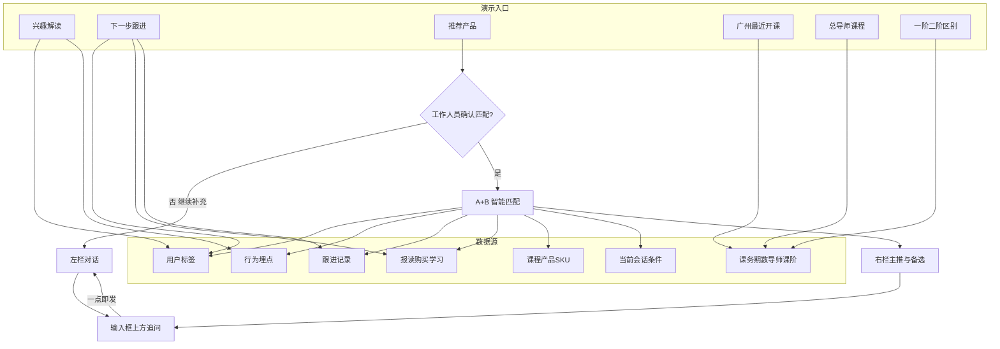

# 学员画像分析助手大型工作台设计

> 日期：2026-08-27  
> 范围：仅修改学员画像中的分析助手，不修改画像主体、意向列表、策略模板、会务菜单或 APP  
> 适用端：会务后台 PC、已授权面谈官门户

## 1. 目标

把画像页右下角 `380 × 520` 的小型问答弹窗升级为大型双栏分析工作台，使会务工作人员能够：

1. 查询系统中已有的学员信息；
2. 基于画像、跟进及行为数据分析下一步销售动作；
3. 在对话补充条件后，智能匹配预算内的课程产品，并查看完整产品、课务和商品资料。

工作台只提供分析和参考，不发起订单、不加入购物车、不复制沟通话术。

## 2. 范围边界

### 2.1 本次修改

- 分析助手浮层、对话、历史入口、推荐区及动效；
- 分析助手所需 Mock 会话、标签、埋点、产品、课务及商品数据；
- 会务后台与面谈官门户复用同一助手能力；
- 助手内部状态、匹配版本与历史快照。

### 2.2 明确不修改

- 画像三栏及其现有卡片；
- 学员意向列表和明细抽屉；
- 标签平台和意向策略模板；
- 会务 APP；
- 正式 Dify 接口、订单、支付、购物车及报读写操作。

## 3. 工作台信息架构

### 3.1 打开方式

- 点击画像工具栏「AI 分析对话」或右下角「问学员」；
- 打开约 `90vw × 88vh` 的大型浮层；
- 关闭后回到原画像及原滚动位置；
- 会务后台和面谈官门户使用相同工作台，面谈官仍为只读业务角色。

### 3.2 双栏布局

左栏为当前对话：

- 当前学员及会务上下文；
- 外侧可收起演示按钮（分析 3 + 课务检索 3）；
- 多轮消息；
- 匹配条件摘要；
- 「继续补充信息 / 按当前条件匹配」交互；
- 输入框上方 3 条追问；
- 文本输入区；
- 工作台内「意图流注释」（流程图 + 数据源说明）。

右栏为产品结果：

- 初始为空状态；
- 匹配中显示 A+B 融合动效；
- 完成后显示主推 1 个和备选 1～2 个；
- 点击产品后，在同一右栏切换到产品详情；
- 产品详情顶部提供返回推荐列表；
- 不使用二级弹窗或三张卡片原位长展开。

### 3.3 历史入口

- 历史入口放在助手头部，以按钮和抽屉呈现，不常驻第三栏；
- 历史会话归提问工作人员 `user_id`，不写入学员公共档案；
- 历史范围跨会务、跨学员；
- 支持按学员、会务、标题、日期搜索和切换；
- 不提供重命名或删除；
- 点击其他学员历史时，底层画像同步导航到该学员，再恢复会话。

## 4. 会话与版本

### 4.1 新会话

- 每次进入学员画像都创建一条内存中的空白会话；
- 不自动续接最近会话；
- 首次发送问题或开始匹配后才落历史，空白会话不保存；
- 首轮问题自动生成会话标题；
- 单条会话支持连续多轮对话。

### 4.2 数据快照

- 每条历史消息及每次匹配版本记录当时的数据截止时间；
- 打开历史时展示原始答案和原始匹配结果；
- 继续追问时读取最新画像；
- 若标签、跟进、埋点、报读或购买发生变化，先提示变化，再生成新答案；
- 不用最新数据重写旧消息。

### 4.3 推荐版本

- 同一会话可多次匹配；
- 每次匹配保存条件快照、明确条件、推断条件、置信度、依据和产品结果；
- 右栏默认展示最新版本；
- 可回看「第 1 次 / 第 2 次」匹配；
- 新信息出现后，助手继续提供「按新增信息重新匹配」按钮。

## 5. 三个模拟开场意图

### 5.1 兴趣解读

按钮文案：

> 学员在系统中对什么类型的课程感兴趣？

演示逻辑：

- 读取用户标签、社区/学习/视频/直播行为埋点；
- 输出感兴趣的课程方向；
- 每个结论附标签或行为依据；
- 区分事实和 AI 推断；
- 回答后询问是否按当前信息匹配产品。

### 5.2 下一步跟进

按钮文案：

> 学员下一步应该如何跟进？

演示逻辑：

- 读取用户标签「上课层级」；
- 对照真实报读和会务记录，取已验证最高层级；
- 标签与记录冲突时提示不一致；
- 沙龙经验 → 推荐分享会；
- 分享会经验 → 推荐一阶；
- 更高阶关系由生产 Dify 提示词定义，原型用固定 Mock 阶层；
- 同时展示最近的沙龙、分享会报读会务记录；
- 回答后询问是否按当前信息匹配产品。

### 5.3 产品智能匹配

按钮文案：

> 应该推荐什么课程产品比较适合该学员？

演示逻辑：

- 可先追问课程方向、预算、城市等信息；
- 也可直接按已有画像匹配；
- 不设固定字段门槛；
- 每轮补充后都显示「继续补充信息 / 按当前信息匹配产品」；
- 工作人员点击确认后才启动右侧匹配。

## 6. 智能匹配输入

匹配综合使用：

- 当前会话；
- 用户标签；
- 过往跟进内容；
- 页面、内容、学习、视频及直播等行为埋点；
- 报读记录；
- 已购买资格；
- 沙龙、分享会和课程学习历史；
- 当前产品、商品和课务数据。

条件摘要分为：

- `explicit`：工作人员明确提供；
- `inferred`：AI 从画像或行为数据推断；
- `missing`：仍缺失但不阻断匹配。

显式信息较少时仍允许匹配，但必须展示推断来源、置信度及缺失提醒。

## 7. A+B 融合动效

### 7.1 第一阶段：数据星图汇聚

用户标签、过往跟进、行为埋点、报读购买四类数据，以发光节点和数据流向 AI 核心汇聚，体现多源数据驱动。

### 7.2 第二阶段：可解释匹配管线

依次高亮：

1. 理解当前需求；
2. 归纳学员画像；
3. 检索产品与课务；
4. 执行预算与 SKU 硬校验；
5. 综合排序并生成推荐依据。

### 7.3 时长

- 原型固定播放约 8～9 秒；
- 生产跟随真实接口，不人为延迟；
- 接口慢时停留在当前阶段；
- `prefers-reduced-motion` 时关闭大幅动画，保留文本进度。

## 8. 产品推荐规则

### 8.1 数量与单位

- 推荐单位为课程产品，不以单一商品 SKU 为主推；
- 主推 1 个，备选 1～2 个；
- 推荐卡显示名称、匹配度、预算状态、已购买/已报读关系和主要依据。

### 8.2 预算

- 预算通过自然语言提取，不设单独预算表单；
- 未明确预算时先追问；
- 预算为硬上限；
- 产品至少有一个当前可售 SKU 不超过预算才可进入主推或备选；
- 无预算内产品时返回免费/低价路径或暂无匹配。

### 8.3 产品详情

详情顺序：

1. 产品介绍；
2. 3 个课务期数；
3. 全部商品/SKU。

商品规则：

- 预算内商品优先，标「符合预算」；
- 超预算商品置后，标「超出本次预算，仅供了解」；
- 商品仅用于工作人员参考，不提供购买操作。

### 8.4 课务期数

- 每个产品展示 3 个；
- 只取当前或未来；
- 状态仅为「正在开课中」或「报读中」；
- 同城优先；
- 再按正在开课中、报读中、开课时间由近到远排序；
- 同城不足 3 个时补其他城市最近期数；
- 展示期数名称、城市、导师、开课起止时间和状态；
- 点击可查看课务详情，不直接报读。

## 9. 购买、报读与进阶术语

- `已购买`：学员拥有该课程报读资格；
- `已报读`：资格已核销，并选择或参加具体课务期数；
- 拥有资格但未报读：提醒使用资格完成报读，并展示 3 个可选期数；
- 已报读：允许建议未来复训；
- 只要历史上已报读过，即默认可建议复训，不额外校验复训政策；
- 已报读或已完成产品默认不作为首次主推；
- 只有工作人员明确询问复训、升舱或权益时，才重新推荐已上产品；
- 已到最后一阶时不虚构更高阶课程。

## 10. 失败和兜底

- Dify 或匹配接口失败时保留会话及条件；
- 展示失败原因和「重新匹配」；
- 同时展示固定 Mock 兜底产品；
- 兜底产品仍执行预算硬过滤；
- 明确标注「兜底参考 · 非智能匹配」；
- 失败不生成正式智能匹配版本；
- 生产环境由智能体调用兜底产品接口，原型只模拟。

## 11. 原型状态覆盖

必须可演示：

- 初始空白会话；
- 三个开场意图；
- 多轮补充信息；
- 条件摘要与匹配确认；
- A+B 匹配动效；
- 成功推荐列表；
- 产品详情；
- 课务与商品；
- 再次匹配及版本切换；
- 历史搜索与切换；
- 数据变化提示；
- 匹配失败与兜底产品；
- 已购买未报读；
- 已报读可复训；
- 标签层级与报读记录冲突。

## 12. 数据结构

```js
Session = {
  id,
  userId,
  memberId,
  conferenceId,
  title,
  createdAt,
  updatedAt,
  messages: [],
  matchVersions: []
}

MatchVersion = {
  id,
  createdAt,
  dataAsOf,
  explicitConditions: [],
  inferredConditions: [],
  missingConditions: [],
  confidence,
  status, // matching | success | failed | fallback
  products: []
}

ProductRecommendation = {
  productId,
  productName,
  matchPercent,
  relationStatus, // none | qualified | enrolled
  reasons: [],
  description,
  sessions: [],
  goods: []
}
```

原型数据仅保存在浏览器 `localStorage`；正式接口不在本次范围。

## 13. 验收标准

1. 仅分析助手相关文件和两个画像页的助手引用发生变化；
2. 两端打开的是同一大型双栏工作台；
3. 三个意图均可走通完整流程；
4. 匹配前必须有工作人员确认按钮；
5. A+B 动效完整播放；
6. 推荐结果遵守预算硬上限；
7. 产品详情含介绍、3 个有效课务期数和全部商品；
8. 历史按工作人员隔离，旧结果不被新数据覆盖；
9. 失败兜底明确标识；
10. 原画像主体、意向列表和策略模板无视觉或行为变更。

## 14. 原型 Mock 与生产 Dify

本工作台中的对话回复、检索结果、匹配产品、课务期数、商品/SKU、兜底数据和动效节奏 **全部是演示用模拟数据**。

正式环境以 **Dify 智能体回传** 为准：

- 意图识别、追问生成、条件抽取、销售建议由 Dify 输出；
- 期数、名额、价格、可售商品由业务 HTTP 接口返回，不由模型编造；
- 匹配动效跟随真实接口进度，不固定 8～9 秒；
- 本原型的按钮文案、固定剧本和 Mock JSON 只用于演示与验收，不作为生产口径。

## 15. 演示按钮与输入框追问

### 15.1 外侧演示按钮

左栏外侧两组演示按钮，便于现场点选剧本：

| 组 | 文案 | 类型 |
|----|------|------|
| 分析学员 | 学员在系统中对什么类型的课程感兴趣？ | 分析意图 |
| 分析学员 | 学员下一步应该如何跟进？ | 分析意图 |
| 分析学员 | 应该推荐什么课程产品比较适合该学员？ | 分析意图 |
| 课务检索 | 广州最近有哪些课程正在开课？ | AI 智搜原句 |
| 课务检索 | 总导师的课程有哪些？ | AI 智搜原句 |
| 课务检索 | 一阶和二阶有什么区别？ | AI 智搜原句 |

规则：

- 空白会话默认展开；发出第一句后自动收起；演示时再展开选一句；
- 一点即发，同一会话追加，不新开会话、不清空右侧已有推荐；
- 检索类只在左栏作答，不出现 C 端报读按钮，不自动触发右侧智能匹配。

### 15.2 输入框上方追问条

- 等助手回复完成后出现；A+B 匹配动效期间隐藏；
- 每轮 3 条：2 条阶段底盘 + 1 条贴上一句；
- 点击即作为工作人员新问题发出并立刻作答；
- 重新匹配只走对话内条件卡，不进追问条；
- 产品细节追问只在左栏回答，右侧不自动跳转。

| 阶段 | 底盘 1 | 底盘 2 | 第 3 条 |
|------|--------|--------|---------|
| 分析后 | 下一步如何跟进 | 推荐什么产品 | 贴上一句 |
| 检索后 | 南宁站还有吗？ | 总导师最近有哪些期数可以报读？ | 贴上一句或转向匹配 |
| 已有推荐 | 主推课程介绍 | 最近一期课务和商品 | 贴上一句（含新补充如「亲子方向」） |

## 16. 意图流与数据源

| 意图 | 触发 | 左栏产出 | 右栏 | 数据源（原型 Mock / 生产） |
|------|------|----------|------|---------------------------|
| 兴趣解读 | 演示按钮 / 追问 / 自由输入命中 | 兴趣方向 + 标签/埋点依据 | 不变 | 用户标签；社区/学习/视频/直播埋点 |
| 下一步跟进 | 同上 | 进阶建议 + 报读会务记录 | 不变 | 标签「上课层级」；报读/购买；跟进记录 |
| 产品匹配准备 | 产品按钮或「要不要匹配」 | 条件摘要 + 确认按钮 | 仍空 | 当前会话；标签；跟进；埋点；报读购买；近 12 月消费 |
| 智能匹配 | 工作人员点「按当前条件匹配」 | 保留条件卡 | A+B 动效 → 主推+备选 | 上表全部 + 课程产品/SKU + 课务期数接口 |
| 城市期数检索 | 「广州最近有哪些课程正在开课？」 | 可报读/开课中期数列表 | 不变 | 课务期数（城市、时间窗、状态） |
| 导师课程检索 | 「总导师的课程有哪些？」 | 导师相关课程 + 可展期数 | 不变 | 导师词典；课程-导师关系；课务期数 |
| 课阶区别 | 「一阶和二阶有什么区别？」 | 课阶说明 | 不变 | 课程阶别知识（Dify 提示词 / 知识库） |
| 检索续聊 | 「南宁站还有吗？」等 | 续聊期数 | 不变 | 继承上文课名/导师 + 新城市期数 |
| 产品细节追问 | 介绍 / 课务商品 | 左栏说明 | **不跳转** | 当前推荐版本中的产品介绍、3 个期数、全部 SKU |
| 失败兜底 | 模拟失败或接口失败 | 失败原因 | 兜底产品（标注非智能匹配） | 兜底产品接口；仍走预算硬过滤 |

生产链路：工作人员输入 → Dify 识别意图并抽槽 → 业务 HTTP 取标签/埋点/跟进/报读/产品/期数 → Dify 组织回答与是否询问匹配 → 仅确认后才写右侧推荐版本。



该图同时作为工作台旁「意图流注释」和页内红点注释展示。原型节点走 Mock；生产将 Entry 后的识别与生成替换为 Dify，Data 替换为对应 HTTP。
