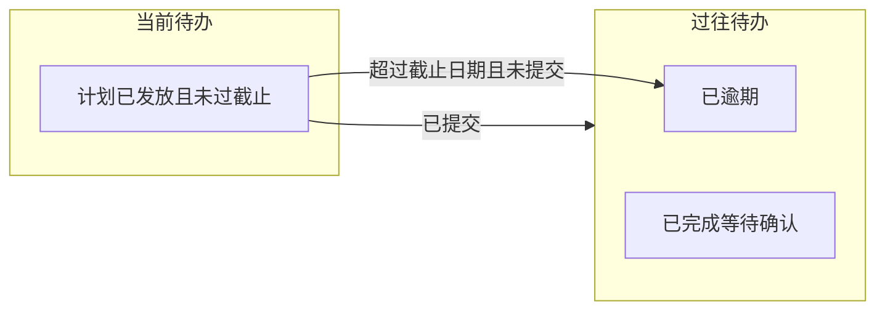

# Grill 会话记录 · OA 内部绩效

> 以《绩效模块功能清单 V1.0》为主索引，逐条对齐；完整清单见 `FEATURE_LIST.md`。

## 清单结构概览（我的理解）

| 一级模块 | 条目数 | 典型用户 |
|----------|--------|----------|
| 考核者（员工）端 | 18 | 被考核员工 |
| 绩效评价者（上级）端 | 11 | 直接上级、分管领导 |
| 管理部门（HR/管理员）端 | 22 | HR、绩效管理员 |

**1.0 明确暂不处理**（备注/反馈）：部门 OGSM 目标关联(#37)、人力资源数据关联(#47)、全年综合得分(#48)、评分关系临时调整(#52)。

**待逐条确认**：其余 47 条 + 无序号子项（#13 年度提交、#31 模板管理、#35 6Q3J）。

## 对齐进度

| 条目 | 功能 | 状态 |
|------|------|------|
| #1 | 月度指标制定 | ✅ 已确认（含时机修订） |
| #2 | 上月指标一键带入 | ✅ 已确认 |
| #3 | 指标权重分配 | ✅ 据官方月表确认（四区块） |
| 模板 | 月表 + 季表 V1.2 | ✅ 已入库 |
| 批次计划 | 考核计划发放机制 | ✅ MVP=A + 周期唯一性约束 |
| #4 | 下月目标智能预填 | ✅ 已确认 |
| 任务可见性 | 待办 vs 过往 | ✅ 已确认 |
| #5–#8 | 填表向导 / 步骤条 | ✅ B 三大段 + 解锁断点续填 |
| #12 | 月度提交流程 | ✅ MVP 已确认（完整流程待补） |
| #14 | 被退回后修订 | ✅ A 向导断点续改 |
| #10 | 加减分事项申报 | ✅ C + 评分人边界 |
| #22 | 上级评分端 | ✅ B OA+小程序 |
| #32 | HR 计划管理（OA） | ✅ C · 人力→绩效→计划管理 |
| 旧页重构 | 员工月/年度绩效 | ✅ 菜单下线(A)，仅「计划管理」 |
| 季度向导 | 步骤结构 | ✅ A 三大段+专步 |
| 数据互通 | 小程序↔OA-PC | ✅ 同一任务数据 |
| 员工填表端 | PC是否可填 | ✅ B 双端续填同步 |
| 员工PC入口 | 个人中心→绩效任务 | ✅ 已确认 |
| 上级PC入口 | 个人中心→绩效·领导Tab | ✅ 已确认 |
| 小程序双Tab | 员工/领导分Tab | ✅ A 与PC一致 |
| #16 | 结果查询/历史 | ✅ 保密+三列表+允许回看自填 |
| 模板+人群 | 花名册全职/办事处；匹配规则暂缓 | 🔄 Grill 暂缓 |
| 填表原型 | prototype/ 员工填表 + HR计划三页 | ✅ MVP |
| #22 上级评分 Grill | 刻度/校验/布局/双端/分管 | ✅ v1.0.0 见 `HANDOFF-v1.0.0.md` |
| 领导评分原型 | OA 月评 + 小程序简版 | ✅ v1.0.0 |
| 审批流 | 用户后续提供 | ⏳ 待文档 |

---

## #1 · 月度指标制定

**路径**：考核者（员工）端 / 目标制定 / 月度指标制定

**我的理解**：
- **时机**：**不强制月初对标**；员工在**当月考核周期内**任意时间均可配置、填写本月 KR（受管理员开放时间窗口约束，见 #33）。
- **字段**：关键目标 O、SMART 考核目标、KR 权重、考核标准。
- **数量**：总监/经理 4–6 项；主管/职员 2–4 项（以管理员模板配置为准）。
- **校验**：少于下限 / 多于上限时系统提醒并限制。

**Q：对标 = 填本月 KR？**

- 用户选 **A**：在线填**本月** KR，作为本月考核依据（**不要求固定在月初**，当月内完成即可）。

**Q：目标数据来源？**

- **终态**：目标主要从**项目系统**拉取该员工的项目/工作目标。
- **MVP 原型**：先按**员工手动填写 KR** 设计；预留「从项目系统导入」占位。

**双端（暂定）**：小程序为主填写；OA 员工端同步或只读，后续页面矩阵再定。

**决策**：✅ 已确认（2026-06-03，时机修订同上）

---

## #2 · 上月指标一键带入

**路径**：考核者（员工）端 / 目标制定 / 上月指标一键带入

**我的理解**：
- **不做静默自动带入**；员工主动选择是否复制上月 KR。
- 提供 **「复制上月指标」按钮**；可选 **轻量提示**（如首次进入空表单时询问「是否复制上月？」），但**不默认写入**。
- 确认复制后：复制上月全部 KR（O / KR 权重 / 考核标准）到本月；每条可 **保留 / 修改 / 删除**。
- 若本月已有内容，复制前需 **二次确认**（防覆盖）。

**用户回答**：不必月初对标；暂不自动带入；按钮或提示询问是否复制上月。

**决策**：✅ 已确认（2026-06-03）

**决策**：✅ 已确认（2026-06-03）

**#3 暂挂**：用户将提供 Excel 模板；已据仓库内 V1.2 解析稿输出 `docs/FORM_TEMPLATE_ANALYSIS.md`，待用户确认是否为同一模板。

---

## 官方模板确认（2026-06-03）

**用户提供**：
- `6Q-VV部V月度绩效考核表1.2版.xlsx` → 表1 月度，员工**每月**填写
- `6Q-VV部V季度绩效考核表1.2版（模版）.xlsx` → 表2 季度，员工**每季**填写

**已入库**：`templates/monthly-v1.2.xlsx`、`templates/quarterly-v1.2.xlsx`

**#3 决策**：固定四区块（V / X / 行为态度 15% / 加减分），详见 `docs/FORM_TEMPLATE_ANALYSIS.md` 第三节。

**批次计划**：见 `docs/BATCH_PLAN_CONCEPT.md`；用户认可「批次自动发放 + HR 手工创建」双模式。

---

## 批次计划 · MVP 范围（待确认）

**推荐**：MVP 仅 **HR 手工创建计划 + 定时/手动发放**；按周期自动生成批次 → 二期。

**用户回答**：**A** — HR 自己控制变量；**硬约束**：同一周期不可重复计划（月度=年+月，季度=年+季度）。

**决策**：✅ 已确认（2026-06-03）

---

## 小程序入口（仅首页宫格，不做原型）

**图1 首页**：自助服务宫格 **新增「绩效」类图标** → 进入 **绩效子模块**（模块内列表/填表/历史）。

**个人中心**：**不修改**（与绩效无关）。

详见 `docs/MINIAPP_ENTRY_IA.md`。

**用户回答**：
- **1 = A**（已修订 ↓）：~~个人中心「填写绩效」~~ **取消** — 个人中心与绩效无关，**不修改**。
- **仅首页**：在「自助服务」宫格 **新增图标入口**，进入 **绩效模块** 内呈现（待办、填写、历史等均在模块内完成）。
- **2 = C**：全公司同一周期仅 1 条计划；明细按 **主要组织** 筛部门。
- **参与范围（2026-06-03 修订）**：~~全公司 checkbox + 部门/职级多选~~ → **范围包 + 全集团组织树**（见 `docs/GRILL_HR_SCOPE.md`）；同一周期仍只能 **一条** 计划。

**决策**：✅ 已确认（2026-06-03，入口策略 2026-06-03 修订）

**计划明细（HR 后台）初步字段**：

| 筛选项 | 来源 |
|--------|------|
| 部门 | 员工「主要组织」 |
| 岗位 / 职级 | 员工主数据 |
| 任务状态 | 未开始 / 填写中 / 已提交 / 已评分 / 已完成 / 逾期 |
| 考核类型 | 月度 / 季度 |

**决策**：✅ 已确认（2026-06-03，入口策略 2026-06-03 修订）

**绩效模块首屏 = A**：进入后默认 **任务列表**（卡片：周期 + 月/季类型 + 状态），点击进入填表页；不在有待办时直达填表。

---

## #4 · 下月目标智能预填

**决策**：✅ **A** — 提交本月考评时，**【B】下月核心目标（3–4 项）须填完** 方可提交（与 Excel 一张表交齐）。

**预填逻辑（清单）**：本月提交后，下月 O + KR 权重可预填至 **下一周期** 任务（#4）；员工确认保留/修改/删除。

---

## 任务列表 · 可见性规则（2026-06-03）

**当前待办（首屏列表）**：
- 仅展示 **正在执行的考核计划** 已发放、且 **未超过截止日期** 的任务
- 超过截止日期 → **不再出现在当前待办**

**过往待办 / 历史**：
- 逾期未交的任务 → 仅在 **过往待办** 中可见，状态 = **已逾期**
- （已提交、已评分等完成态 → 也应在此查看，待下题确认 Tab 结构）



**与 HR 解锁 (#41) 关系**：⏳ 待确认 — 截止后 HR 解锁延期，任务是否回到「当前待办」？

---

## #5 · 填表形态：单任务 + 多页步骤条（2026-06-03）

**业务 = A**：同一考核任务、同一开放周期内，KR → 自评 → 下月目标 **一次提交闭环**（非两阶段锁定）。

**交互 = 多页向导**：尽可能 **拆成多个页面**，顶部 **步骤条（Stepper）**，逐步填写直至完成提交。

**用户原话**：例如 **核心目标** 与 **其他类型** 分页面填；步骤条引导到完成。

### 月度任务 · 建议步骤（待确认）

| Step | 页面 | 对应表区块 / 清单 |
|------|------|-------------------|
| 1 | **核心绩效（V%）** | 新增/编辑 KR：O、SMART、权重、考核标准 |
| 2 | **常规绩效（X%）** | 同上 |
| 3 | **行为态度（15%）** | 模板固定项 + 关键事件（选填） |
| 4 | **加减分** | 事项库选择 + 说明 + 佐证 |
| 5 | **自评打分** | 关键成果 M + 各行自评分 + 综合分预览（#6–#8） |
| 6 | **自评总结** | 本期总结（#9） |
| 7 | **下月核心目标** | 【B】区 3–4 项（#4，提交前必填） |
| 8 | **确认提交** | 校验权重 100%、必填项、下月目标 |

- 步骤间 **自动保存草稿**；可返回上一步修改
- 步骤条显示完成态（✓ / 当前 / 未达）
- **未过截止** 前均可编辑；提交后按流程状态锁定

**季度任务**：步骤类似，但增加 **6Q3J（只读）**、**面谈记录**、**下季目标 2–3 项** 等页（季表专章另列 spec）。

**HR 解锁 (#41)**：✅ 解锁后任务 **回到「当前待办」**，员工从 **断点步骤** 继续填写（保留已填草稿与步骤进度）。

**步骤条样式 = B**：三大段 — **制定目标(1–4)** → **自评(5–6)** → **下月与提交(7–8)**；段内子步 1→8。

**决策**：✅ 已确认（2026-06-03）

---

## #12 · 月度数表单提交 / 审批流（下一题）

**路径**：考核者端 / 提交流程 / 月度数表单提交

**清单**：提交时校验权重 100%、分数上限、必填项；需走 **提交流程**；默认经理级以上上级评分；上级休假可 **转评价人**（人才部反馈）。

**待确认 — 提交后第一个审批节点**：

**用户回答（MVP）**：
- 方向认同 **B**（含分管等完整链路），但 **完整审批流程后续单独提供**
- **当前 MVP**：提交后 **仅直接上级** 作为下一处理人（评分/审批）
- 审批 **结束后**：由 **HR 负责人** 做 **统一统计**（汇总看板/导出 #42，非员工侧必审节点）

**决策**：✅ MVP 已确认；完整流程 **⏳ 待用户提供审批流程文档** 后迭代

详见 `docs/WORKFLOW_MVP.md`。

---

## #14 · 被退回后修订

**决策**：✅ **A** — 退回后进 **填表向导断点步骤** 修改；展示 **退回原因** + **退回历史**；再提交 **不作废** 重走全流程，仍至直接上级（MVP）。

与 HR **解锁断点续填** 交互一致。

---

## #10 · 加减分事项申报

**决策**：✅ **C** — 员工可 **自评加减分** 并申报事项；**上级 / 总经理** 在各自环节可 **核定、改分或追加条目**（仍限于评分权限内）。

### 评分权限边界（用户明确，全局适用）

**仅以下角色** 可对绩效表内指标 **填写/评分**：

| 角色 | 典型环节 |
|------|----------|
| **自己（员工）** | 自评、加减分申报与自评分 |
| **直接上级** | 上级评分、加减分核定 |
| **总经理** | 可选修改/确认（完整审批流到位后；#51 非必须节点） |

**其余任何人**：
- ❌ 不可评价  
- ❌ **不会收到** 该绩效表待办  

> 「指定评价人」≠ 任意跨部门人员；**转办/代评** 也须在 上级/总经理 体系内配置（如上级休假转上级级他人 — 待审批流文档）。

加减分 **事项库**（#35）仍由 HR 维护；**6Q3J 客观分** 为系统导入，非人工评价待办。

---

## #22 · 月度评分 · 上级端

**决策**：✅ **B** — **OA 应用 + 小程序** 均可做上级评分（双端待办均可达）。

**推荐能力分工（待确认）**：

| 能力 | OA PC | 小程序 |
|------|-------|--------|
| 下属列表 + 状态 | ✅ | ✅ |
| 单人完整评分表 | ✅ | ✅ |
| Tab 快速切换 (#22) | ✅ | 简化 |
| 批量同指标评分 (#26) | ✅ | ❌ 或极简化 |
| 宽表一眼多人 | ✅ | 卡片逐人 |

---

## #32 · HR 创建考核计划（OA 后台）

**决策**：✅ **C** + 挂载位置：

```
OA-PC → 人力资源 → 绩效管理 → 【计划管理】（新）
```

- **忽视** 现有「员工月度绩效 / 员工年度绩效」旧页（人×年月得分表），**整模块按批次计划重构**
- **MVP 三页**：计划列表 · 新建向导 · 计划明细（`OA_HR_MENU_IA.md`）
- 明细支持按 **主要组织/部门** 筛选（与员工 roster 字段一致）

**旧菜单 MVP**：✅ **A** — **下线**「员工月度绩效」「员工年度绩效」，仅保留 **「计划管理」**。

---

## 季度填表 · 小程序向导

**决策**：✅ **A** — 与月度类似 **三大段**，插入 **6Q3J(只读)、加减分、面谈** 等专步（约 10–11 步）。详见 `MINIAPP_FORM_WIZARD.md`（待补季表逐步清单）。

**数据互通**：✅ 小程序与 **OA-PC 共用同一任务 ID / 后端数据**（计划明细、上级评分、员工填表、状态、断点步骤）。见 `docs/DATA_SYNC.md`。

---

## 员工填表端

**决策**：✅ **B** — 员工 **小程序 + OA-PC** 均可填 **同一任务**；步骤/草稿 **服务端同步**，任一端 **断点续填**。  
冲突：**后保存生效** + 提示「已在其他端更新」（`DATA_SYNC.md`）。

---

## 员工填表端

**决策**：✅ **B** — 小程序 + OA-PC 双端续填同步。

**OA-PC 员工入口**：✅ **个人中心 → 绩效 → Tab【员工】我的待办**  
**OA-PC 上级入口**：✅ **个人中心 → 绩效 → Tab【领导】待我审核**（#22-A，须 **标注角色**，与员工 Tab 分列）  
**小程序**：首页宫格「绩效」（不改「我的」）  
详见 `OA_PERSONAL_CENTER_PERF.md`（原 `OA_EMPLOYEE_ENTRY.md` 已合并意图）。

---

## 小程序「绩效」模块 · 是否同样双 Tab？（下一题）

OA-PC 已在个人中心用 **员工待办 | 领导待审** 分 Tab。

**待确认 — 小程序**（#22-B 上级也可在小程序评）：

- **A.** **同样双 Tab**：【我的待办】|【待我审核】，与 PC 一致
- **B.** 小程序 **仅员工待办**；上级 **只在 OA-PC**「领导 Tab」评
- **C.** 小程序单列表，顶部 **切换「员工/领导」** 分段器（非 Tab 栏）

**推荐 A**（与 PC 心智一致，上级外出可手机审）。

**决策**：✅ **A** — 小程序与 OA-PC **同样双 Tab**（员工待办 | 领导待审）。

---

## #16 · 员工侧可见性 / 列表结构

**保密规则（用户明确）**：
- ❌ 员工 **不可查看上级对自己的评分**（含上级分、含上级权的综合分、上级评语等 — **保密**）
- ✅ 员工 Tab 内 **不需要「历史结果/查分」** 一类展示上级评价的页面

**【员工】我的待办 · 子列表**（仅三项）：

| 子 Tab | 内容 | 可见字段 |
|--------|------|----------|
| **当前待办** | 计划执行中、未过截止、需填写/可续填 | 填表向导全部（自评阶段仅自评相关） |
| **逾期** | 过截止未提交（HR 未解锁） | 只读摘要或仅状态「已逾期」；**无上级分** |
| **过往提交** | 本人 **已提交** 过的任务（流程中或已结束） | 考核期、类型、提交时间、状态（如已提交/审批中）；**可回看本人填写的自评内容与自评分**；❌ **隐藏上级评分、综合核定分、等级、上级评语** |

> 清单 #16「查看结果、近 12 月历史、导出统计」若含上级评价，**员工端不实现** 或仅 HR/本人统计不含上级分 — 待 spec 与人才部确认。

**与清单 #16 差异**：员工端 **不做** 面向员工的「考核结果查分」；**过往提交** 仅证明已交 + 回看 **自有填写内容**。

**待确认**：过往提交中员工 **自评分 / 自评总结 / 自己填的 KR** 是否允许回看？

**决策**：✅ **允许** — 可回看 **本人填写** 的 KR、自评总结、自评分等；**上级评分/评语/综合核定结果** 仍 **不可见**。
