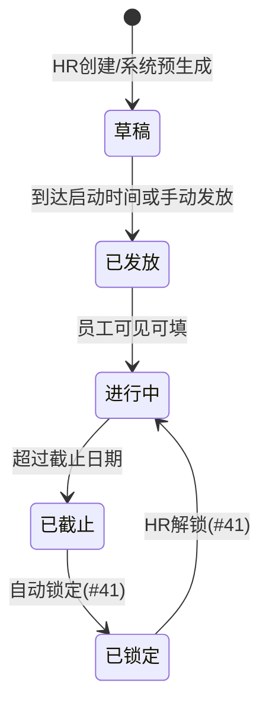

# 考核计划 / 批次 · 概念草案

> 来源：产品方说明（2026-06-03）。与清单 #33/#34（考核时间/周期配置）对应。

## 1. 核心对象

| 对象 | 说明 |
|------|------|
| **考核模板** | 月表 V1.2 / 季表 V1.2，按职级绑定（HR 配置，清单 #31） |
| **考核计划（批次）** | 一次「可填写任务」的实例，如「2026年5月月度考核」「2026 Q2 季度考核」 |
| **考核任务** | 计划 × 员工 = 一条待办（一张电子表） |
| **发放** | 计划到达开放时间后，任务对员工可见（通知 + 待办） |

## 2. 两种创建方式

### 2.1 自动生成（推荐作二期或配置开关）

```
考核周期配置 (#34)
    ↓  cron / 定时任务
按规则生成「计划草稿」
    ↓  到达「启动日期」(#33)
批量生成员工任务 + 发放
```

**规则示例**：
- 月度：每月 1 日 08:00 生成「当月月度计划」，启动日=1 日，截止=25 日  
- 季度：每季末月 1 日生成「当季季度计划」

### 2.2 HR 手工创建（MVP 必做）

HR 在 OA 端：

1. 新建计划 → 选 **月度 / 季度**  
2. 选 **参与范围**（组织/职级/人员）  
3. 选 **绑定模板**（自动按职级匹配月表/季表 Sheet）  
4. 设 **开放时间**（启动、截止、上级评分截止，#33）  
5. 点击 **发放** 或 **定时发放**

## 3. 计划状态机



## 4. 员工侧体验

- 小程序 **当前待办**：仅「计划已发放 **且未过截止**」的任务；**过截止不可见**于当前列表
- **过往待办**：逾期任务状态 = **已逾期**；已提交等完成态亦在此查看
- 同月 **仅一张** 月表；同季 **仅一张** 季表
- 批次关闭后只读；**HR 解锁 (#41)**：任务回 **当前待办**，员工 **断点步骤** 继续填（记日志）

## 5. 与清单条目映射

| 清单 | 批次机制 |
|------|----------|
| #33 考核时间设置 | 计划级：启动/截止/上级评分截止 |
| #34 考核周期配置 | 自动生成的规则源 |
| #15 提交截止提醒 | 计划截止前 N 天通知 |
| #38 进度看板 | 按计划/批次聚合状态 |
| #39 催办 | 按计划批次一键催办 |

## 6. MVP 范围（已确认 2026-06-03）

**用户选择 A**：MVP **HR 手工创建计划**，变量由 HR 控制；**自动生成批次 → 二期**。

### 6.1 计划唯一性（硬约束）

同一参与范围内，**不允许重复计划**：

| 考核类型 | 唯一键 | 示例冲突 |
|----------|--------|----------|
| 月度 | `(年, 月)` | 不可同时存在两个「2026年5月」月度计划 |
| 季度 | `(年, 季度)` | 不可同时存在两个「2026 Q2」季度计划 |

- 创建/保存时前端 + 后端校验；冲突提示：「该周期计划已存在」。
- 「参与范围」不同是否允许两条同周期计划？**否** — 全公司周期唯一（用户确认 C）。
- 部门维度：不拆计划，在 **计划明细** 中按员工 **主要组织** 筛选（与 OA 员工列表字段一致）。

### 6.3 计划明细（HR 视图）

一条全公司计划下发后，明细行 = **计划 × 员工**：

| 列（示例） | 说明 |
|------------|------|
| 员工姓名 / 工号 | 主数据 |
| **主要组织** | **可筛选、可分组** |
| 岗位 / 职级 | 可筛选 |
| 任务状态 | 进度看板 #38 钻取来源 |
| 综合得分 / 提交时间 | 可选列 |

支持：按部门筛选、导出（#43）、催办 (#39)。

### 6.2 HR 可控变量（MVP）

- 考核类型：月 / 季
- **参与范围（用户确认 B）**：创建时勾选 — 全公司 / 指定部门 / 指定职级 / 指定人员（同一周期仍仅 **一条** 计划）
- 绑定模板（按职级自动匹配月表或季表）
- 开放时间：启动、截止、上级评分截止
- 发放方式：立即发放 / 定时发放
