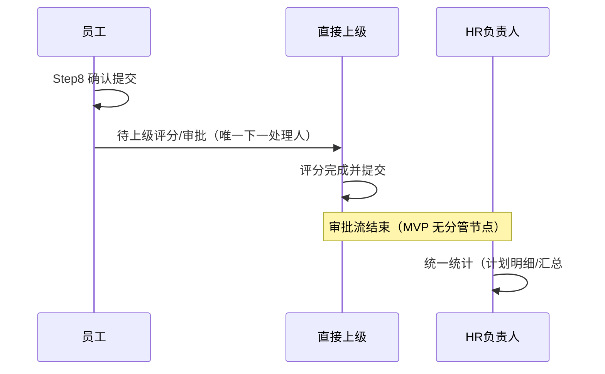

# 审批与统计 · 流程草案（MVP，不做原型）

> 用户说明：完整审批流程 **后续单独提供**；当前按简化链路设计原型与 spec。

## MVP · 月度提交后（2026-06-03）

| 阶段 | 处理人 | 说明 |
|------|--------|------|
| 提交 | 员工 | Step8；校验权重/必填/下月目标 |
| **待上级处理** | **直接上级（唯一）** | 评分 + 审批；清单 #22 |
| 审批结束 | — | MVP 到此结束员工侧可见流程 |
| **统计** | **HR 负责人** | 非必审节点；对 **已结束** 任务做汇总、导出、等级评定等 |

## 待用户后续提供

- [ ] **完整审批流程图**（含分管领导审核 #51、总经理可选节点等）
- [ ] HR 统计触发条件：逐条上级完成即入统计 vs **计划截止后批量统计**

## 评分权限（全局）

仅 **员工本人 | 直接上级 | 分管领导** 可对表内指标评分或改分（月度 MVP 以直接上级为主；季度含分管列）。  
其他人员 **不生成待办、不可见评分入口**。

### 上级与分管同人

若两节点处理人为同一人：**只出一条待办**；提交后分管分数自动粘贴并完结。详见 `docs/GRILL_BONUS_RULES.md` §7。

## 已挂起（完整流程到位后再启用）

- 分管领导审核（#51 月度）— 非同人场景已在奖金结算启用
- 总经理修改评分/确认（可选非必须）
- 上级休假 → **转评价人**（#12 人才部反馈）

## 与任务状态映射（MVP）

| 员工侧状态 | 说明 |
|------------|------|
| 填写中 | 未 Step8 提交 |
| 已提交 / 待上级 | 等直接上级 |
| 已评分 / 已完成 | 上级已提交；员工可在过往/结果中查看 |
| 已退回 | 进向导断点步骤修改；展示退回原因与历史；再提交不作废重走（#14-A） |
| 已逾期 | 过截止未提交；HR 解锁可续填 |

## 季度流程

另文档；MVP 同样可先 **直接上级 + 分管** 简化为仅上级，待审批流文档合并。
